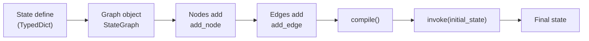
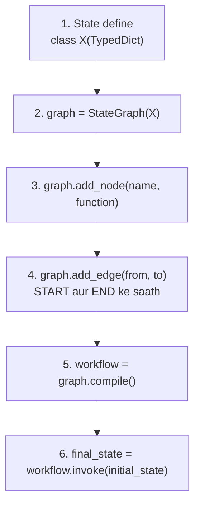
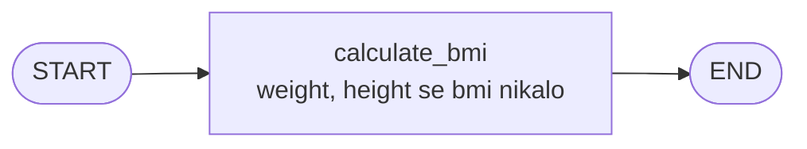
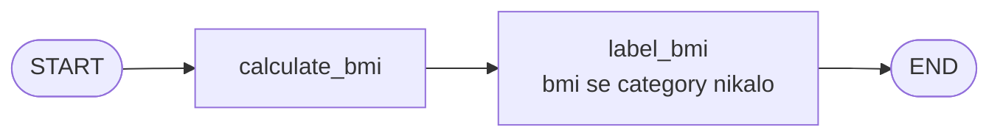
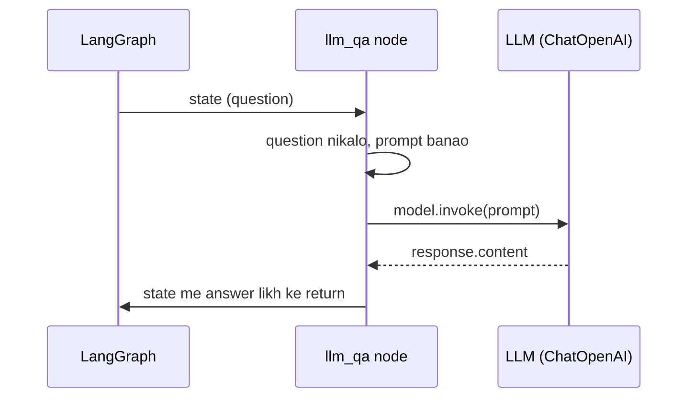
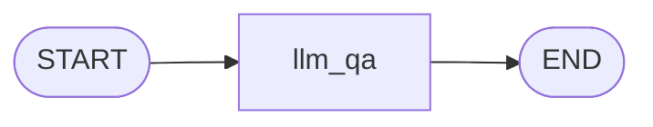
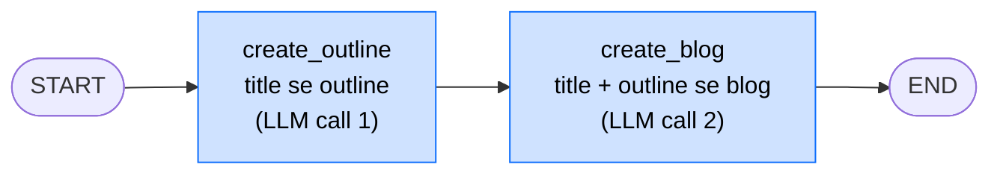
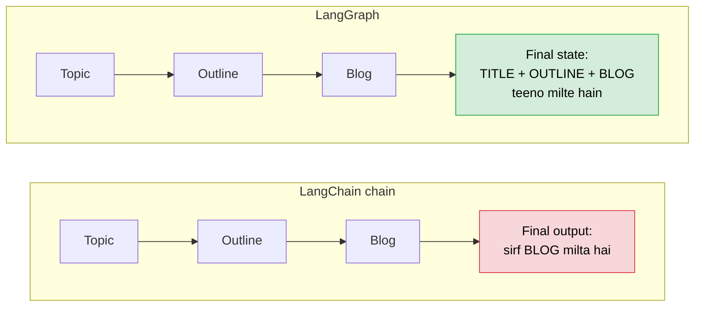
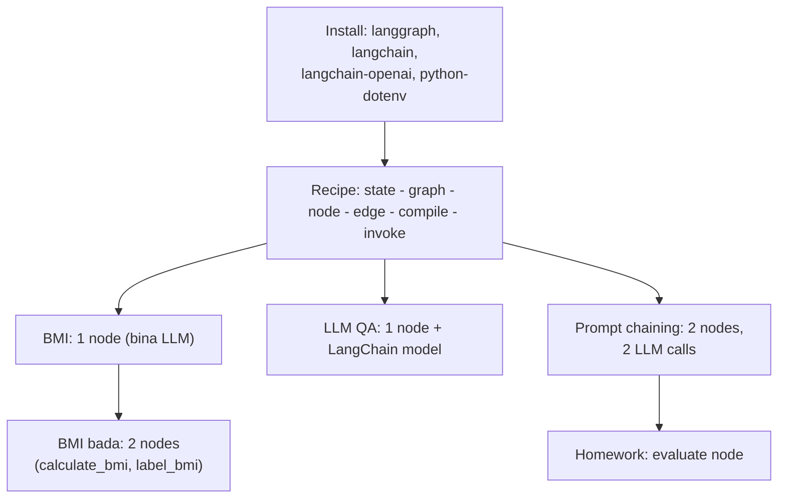
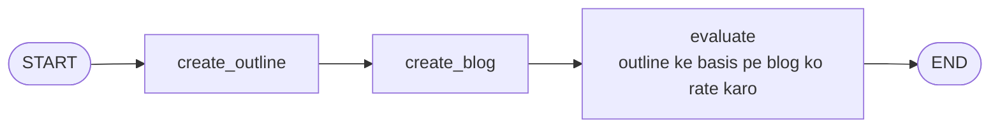

# 05 — LangGraph me Sequential Workflows (pehla coding video)
*(Agentic AI playlist, Video 5: install, BMI workflow, simple LLM QA, Prompt Chaining blog generator)*

> 📌 Har section: **📝 Notes** (likha hua) → **🗺️ Diagram** → **💻 Code** → **🧠 Yaad rakho**.
> Diagrams Mermaid me hain (GitHub / VS Code preview me render hote hain).
> 🔧 = extra jo video me nahi tha (par kaam ka hai).

---

## ⚡ TL;DR (30 second me)

| Cheez | Ek line me |
|---|---|
| **Sequential workflow** | Tasks seedhi line me: ek ke baad ek. Koi branching nahi, koi parallel path nahi |
| **Graph banane ke 5 steps** | State define → `StateGraph(State)` → `add_node` → `add_edge` → `compile` → `invoke` |
| **Node function** | Input me **state** leta hai, state me **partial update** karta hai, **state return** karta hai |
| **START / END** | Dummy nodes jo batate hain graph kahan se shuru aur kahan khatam |
| **`invoke(initial_state)`** | Graph chalata hai, aur **final state** wapas deta hai |
| **LangChain + LangGraph** | Workflow LangGraph me, LLM / prompts jaise components LangChain se |
| **LangGraph ka fayda** | State me **saare intermediate values** (title, outline, content) end tak milte hain |



---

## 1. Video ka goal

### 📝 Notes
- Ab tak (videos 1 se 4) **theory** thi. **Aaj se practical coding shuru.** Ab har video me kuch na kuch code karke banayenge.
- Aaj ka topic: **Sequential workflows** (tasks **linear fashion** me connected: pehla, phir doosra, phir teesra).
- 2 goals:
  1. **LangGraph me basic code likhna** seekhna (pehli baar).
  2. Phir **khud se koi bhi sequential workflow** bana paana.
- Video me 3 workflows banenge:

| # | Workflow | LLM use? |
|---|---|---|
| 1 | **BMI calculator** | Nahi (sirf syntax seekhne ke liye) |
| 2 | **Simple LLM QA** | Haan |
| 3 | **Prompt chaining** (title → outline → blog) | Haan (2 baar) |

### 🧠 Yaad rakho
Is video ka maqsad **perfect workflow banana nahi**, **LangGraph ka syntax seekhna** hai.

---

## 2. Setup / Installation

### 📝 Notes
- Desktop pe ek folder (`langgraph-tutorials`), use **VS Code** me kholo. Poori playlist isi folder me (jab tak naya project structure na chahiye).
- Pehle **virtual environment** banao, activate karo, phir libraries install.

| Library | Kyun chahiye |
|---|---|
| `langgraph` | Workflow banane ke liye |
| `langchain` | LLM components (chat models, prompt templates, document loaders, text splitters...). LangGraph me workflow banate ho par **LLM wale components LangChain se hi milte hain** |
| `langchain-openai` | OpenAI ke models use karenge |
| `python-dotenv` | `.env` se environment variables (API key) padhne ke liye |
| `ipykernel` | **Jupyter Notebook** chalane ke liye (VS Code khud install karne bolta hai) |

> **Jupyter Notebook kyun?** Notebook me graph ko **visually print** karke dekh sakte ho. Ye `.py` file me kaam nahi karta. Aage projects me normal `.py` files use karenge.

### 💻 Code (terminal)
```bash
python -m venv myenv
myenv\Scripts\activate          # Windows (Mac/Linux: source myenv/bin/activate)
pip install langgraph
pip install langchain
pip install langchain-openai
pip install python-dotenv
```

**Install test (notebook me):**
```python
from langgraph.graph import StateGraph
# agar suggestion / import chal gaya to installation sahi hai
```

### 🧠 Yaad rakho
LangGraph = workflow. **Components (LLM, prompts) = LangChain.** Dono install karne padte hain.

---

## 3. Kisi bhi graph ko banane ka recipe (sabse important)

### 📝 Notes
Har LangGraph workflow in **steps** me banta hai:

| Step | Kya karna hai |
|---|---|
| 1 | **State define** karo (class jo `TypedDict` se inherit kare) |
| 2 | **Graph object** banao: `StateGraph(YourState)`, **state input me pass karna zaroori** hai |
| 3 | **Nodes add** karo: `graph.add_node("naam", function)` |
| 4 | **Edges add** karo: `graph.add_edge("from", "to")` |
| 5 | **Compile** karo: `graph.compile()` (structure sahi hai ya nahi check) |
| 6 | **Execute** karo: `workflow.invoke(initial_state)` |

### 🗺️ Diagram


### Node ke 3 rules (kisi bhi node function me)
1. **Input:** poori **state** (type hint = tumhari State class).
2. **Kaam:** state se values nikalo, kaam karo, state me **partial update** karo.
3. **Output:** **state return** karo (type hint = wahi State class).

> Node ka **naam** aur uske peeche ke **function ka naam** alag ho sakte hain. `add_node("calculate_bmi", calculate_bmi)`: pehla naam node ka, doosra function ka.

### START aur END
- LangGraph se import: `from langgraph.graph import StateGraph, START, END`
- Ye **dummy nodes** hain: batate hain graph yahan se shuru aur yahan khatam.
- Pehla edge: `START → pehla_node`. Aakhri edge: `aakhri_node → END`.

### Invoke ke baare me
- `workflow.invoke(initial_state)`: initial state me values deke chalao.
- Graph ko **input me state** dete ho, aur jab khatam hota hai to **output me bhi state** (final state) milti hai.

### 🧠 Yaad rakho
**State in, state out.** Graph aur har node, dono me.

---

## 4. Workflow 1: BMI Calculator (bina LLM)

### 📝 Notes
- **Input:** weight (kg) aur height (m). **Output:** BMI.
- Sequential: ek hi kaam, to **ek hi node**.
- **State me 3 keys:** `weight_kg` (float), `height_m` (float), `bmi` (float).
- **Formula:** `BMI = weight / (height ** 2)`.
- Node ke andar:
  1. State se weight aur height nikalo.
  2. BMI calculate karo.
  3. State me `bmi` update karo (**2 decimal places** tak round).
  4. State return karo.

### 🗺️ Diagram


### State evolution
| Key | Shuru me (initial) | `calculate_bmi` ke baad |
|---|---|---|
| `weight_kg` | 80 | 80 |
| `height_m` | 1.73 | 1.73 |
| `bmi` | (nahi diya) | **26.73** |

### 💻 Code
```python
from langgraph.graph import StateGraph, START, END
from typing import TypedDict

# 1. State
class BMIState(TypedDict):
    weight_kg: float
    height_m: float
    bmi: float

# 2. Graph object
graph = StateGraph(BMIState)

# 3. Node function
def calculate_bmi(state: BMIState) -> BMIState:
    weight = state["weight_kg"]
    height = state["height_m"]
    bmi = weight / (height ** 2)
    state["bmi"] = round(bmi, 2)
    return state

graph.add_node("calculate_bmi", calculate_bmi)

# 4. Edges
graph.add_edge(START, "calculate_bmi")
graph.add_edge("calculate_bmi", END)

# 5. Compile
workflow = graph.compile()

# 6. Invoke
initial_state = {"weight_kg": 80, "height_m": 1.73}
final_state = workflow.invoke(initial_state)
print(final_state)   # {'weight_kg': 80, 'height_m': 1.73, 'bmi': 26.73}
```

### 👀 Graph visually dekhna (Jupyter me)
- Docs se uthaya hua code hai, **sirf Jupyter Notebook me chalta hai**, `.py` me nahi. Isiliye notebook use kiya.
- Bas `workflow` jo compiled graph hai wahi pass karo.

```python
# 🔧 LangGraph docs wala visualization code
from IPython.display import Image
Image(workflow.get_graph().draw_mermaid_png())
```

### 🧠 Yaad rakho
- Itna chhota kaam seedha bhi ho sakta tha. Maqsad: **sirf syntax seekhna**.
- Compile ke baad jo object milta hai (`workflow`) uspe `.invoke()` chalta hai.

---

## 5. BMI Workflow ko bada karna (2 nodes)

### 📝 Notes
- **Naya feature:** BMI ke basis pe batao ki bande ki **category** kya hai (underweight / normal / overweight / obese).
- **3 changes** karne padte hain:

| # | Change | Kahan |
|---|---|---|
| 1 | **State me nayi key** `category` (str) | State class me |
| 2 | **Naya node** `label_bmi` + uska function | `add_node` + function |
| 3 | **Naye edges** | `START → calculate_bmi → label_bmi → END` (purana `calculate_bmi → END` hata do) |

- Naye node ke andar: state se `bmi` nikalo, uske basis pe **category** set karo, state return karo.
- `label_bmi` function ek **partial update** karta hai (sirf `category` set karta hai).

### 🗺️ Diagram


### State evolution
| Key | Initial | `calculate_bmi` ke baad | `label_bmi` ke baad |
|---|---|---|---|
| `weight_kg` | 80 | 80 | 80 |
| `height_m` | 1.73 | 1.73 | 1.73 |
| `bmi` | - | **26.73** | 26.73 |
| `category` | - | - | **"Overweight"** |

### 💻 Code
```python
class BMIState(TypedDict):
    weight_kg: float
    height_m: float
    bmi: float
    category: str          # NAYA

def label_bmi(state: BMIState) -> BMIState:
    bmi = state["bmi"]
    # 🔧 standard BMI ranges
    if bmi < 18.5:
        state["category"] = "Underweight"
    elif bmi < 25:
        state["category"] = "Normal"
    elif bmi < 30:
        state["category"] = "Overweight"
    else:
        state["category"] = "Obese"
    return state

graph.add_node("label_bmi", label_bmi)

graph.add_edge(START, "calculate_bmi")
graph.add_edge("calculate_bmi", "label_bmi")   # purana calculate_bmi -> END hata ke
graph.add_edge("label_bmi", END)
```

### 🧠 Yaad rakho
Workflow bada karna = **state me key + naya node + edges badlo.** Bas.

---

## 6. Workflow 2: Simple LLM QA

### 📝 Notes
- **Kaam:** question do → LLM se poochho → answer state me likho.
- **State me 2 keys:** `question` (str), `answer` (str).
- **Ek node:** `llm_qa`. Is node ke andar **LangChain ka chat model** use hota hai. Yahi dikhana hai ki **LangChain aur LangGraph saath me kaise kaam karte hain**.
- **Setup:** `.env` file me **OpenAI API key** rakho, `load_dotenv()` se load karo, `ChatOpenAI()` se model banao.
- **Node ke andar 4 kaam:**
  1. State se **question** nikalo.
  2. **Prompt** banao (f-string).
  3. **`model.invoke(prompt).content`** se LLM ko call karo. `.content` isliye kyunki LLM ke response me bahut cheezein hoti hain, answer sirf `content` me hota hai.
  4. **State me `answer`** likho aur state return karo.

### 🗺️ Diagram




### 💻 Code
```python
from langgraph.graph import StateGraph, START, END
from langchain_openai import ChatOpenAI
from typing import TypedDict
from dotenv import load_dotenv

load_dotenv()                 # .env se OPENAI_API_KEY load
model = ChatOpenAI()          # default model

class LLMState(TypedDict):
    question: str
    answer: str

def llm_qa(state: LLMState) -> LLMState:
    question = state["question"]
    prompt = f"Answer the following question: {question}"
    answer = model.invoke(prompt).content
    state["answer"] = answer
    return state

graph = StateGraph(LLMState)
graph.add_node("llm_qa", llm_qa)
graph.add_edge(START, "llm_qa")
graph.add_edge("llm_qa", END)

workflow = graph.compile()

initial_state = {"question": "How far is moon from the earth?"}
final_state = workflow.invoke(initial_state)
print(final_state)             # poori state
print(final_state["answer"])   # sirf answer
```

### 💡 Ek honest baat (teacher ne khud kahi)
Ye kaam `model.invoke(prompt).content` se **seedha** ho jaata. Itna chhota kaam LangGraph me **overkill** hai ("ghuma ke kaan pakadna"). Par **concepts yahin seekhe jaate hain**, aur complex workflows me **asli power** dikhegi.

### 🧠 Yaad rakho
**LangGraph = workflow, LangChain = LLM component.** Dono **hand in hand** kaam karte hain.

---

## 7. Workflow 3: Prompt Chaining (blog generator)

### 📝 Notes
- **Prompt chaining** = **ek se zyada LLM calls, series me**. Ek hi call me poora kaam nahi hota, isliye task ko todte ho.
- **Kaam:** topic do → LLM pehle **outline** banaye → phir us outline se **blog** likhe.
- Seedha topic se blog nahi, **2 steps** me (isiliye prompt chaining).
- **State me 3 keys:** `title` (topic), `outline`, `content` (blog), teeno `str`.
- **2 nodes:** `create_outline`, `create_blog`.

| Node | Input (state se) | LLM ko prompt | Output (state me) |
|---|---|---|---|
| `create_outline` | `title` | "Generate a detailed outline for a blog on the topic: {title}" | `outline` |
| `create_blog` | `title` + `outline` | "Write a detailed blog on the title: {title} using the following outline: {outline}" | `content` |

### 🗺️ Diagram


### State evolution
| Key | Initial | `create_outline` ke baad | `create_blog` ke baad |
|---|---|---|---|
| `title` | "Rise of AI in India" | same | same |
| `outline` | - | **"Introduction, Historical context..., Future outlook, Conclusion"** | same |
| `content` | - | - | **poora blog** |

### 💻 Code
```python
class BlogState(TypedDict):
    title: str
    outline: str
    content: str

def create_outline(state: BlogState) -> BlogState:
    title = state["title"]
    prompt = f"Generate a detailed outline for a blog on the topic: {title}"
    outline = model.invoke(prompt).content
    state["outline"] = outline
    return state

def create_blog(state: BlogState) -> BlogState:
    title = state["title"]
    outline = state["outline"]
    prompt = f"Write a detailed blog on the title: {title} using the following outline:\n{outline}"
    content = model.invoke(prompt).content
    state["content"] = content
    return state

graph = StateGraph(BlogState)
graph.add_node("create_outline", create_outline)
graph.add_node("create_blog", create_blog)

graph.add_edge(START, "create_outline")
graph.add_edge("create_outline", "create_blog")
graph.add_edge("create_blog", END)

workflow = graph.compile()

initial_state = {"title": "Rise of AI in India"}
final_state = workflow.invoke(initial_state)
print(final_state["outline"])   # outline
print(final_state["content"])   # poora blog
```

### ⭐ LangGraph ka asli fayda yahan dikha: State sab kuch saath leke chalti hai



| | LangChain chain | LangGraph |
|---|---|---|
| Final output me kya | Sirf **last step ka output** (blog) | **Poori state**: title, outline, content |
| Intermediate values | Gayab (alag se handle karne padte the) | State me **shuru se end tak** available |

> Wajah: **state ka concept**. State sab kuch leke chalti hai aur evolve hoti jaati hai.

### 🧠 Yaad rakho
Prompt chaining = **kai node, har node me ek LLM call.** Aur **state me har step ka output safe rehta hai.**

---

## 8. Poore video ka summary



| Concept | Kahan dikha |
|---|---|
| State = TypedDict | Teeno workflows me |
| Node = Python function (state in, state out) | Teeno workflows me |
| Partial update | Har node sirf apni keys badalta hai |
| Linear edges (`START → ... → END`) | Teeno workflows me |
| LangChain + LangGraph saath | LLM QA aur prompt chaining |
| Graph visualization (Jupyter) | BMI workflow me |
| State me intermediate values | Prompt chaining me |

---

## 9. 📚 Homework (teacher ne diya)

### 📝 Kaam
Prompt chaining workflow me **ek teesra node `evaluate`** add karo.
- Prompt: **"Based on this outline, rate my blog"** aur **integer score** generate karo.
- Karna kya hoga:
  1. **State me change:** `score` (int) key add karo.
  2. **Naya node** `evaluate` + function.
  3. **Edges update:** `START → create_outline → create_blog → evaluate → END`.



### 🔧 Hint (kaise sochna hai)
```python
class BlogState(TypedDict):
    title: str
    outline: str
    content: str
    score: int          # NAYA

def evaluate(state: BlogState) -> BlogState:
    prompt = (f"Based on this outline:\n{state['outline']}\n"
              f"Rate this blog:\n{state['content']}\n"
              f"Respond with only an integer score out of 10.")
    state["score"] = int(model.invoke(prompt).content)   # 🔧 int me convert
    return state
```
> Pehle khud try karo, phir hint dekho.

---

## 10. Glossary

| Term | Matlab |
|---|---|
| Sequential workflow | Tasks linear fashion me, koi branching / parallel nahi |
| `StateGraph` | Graph banane wali class (state input me deni padti hai) |
| `TypedDict` | State banane ki special dictionary class |
| `add_node(name, fn)` | Graph me node jodna |
| `add_edge(a, b)` | Do nodes ke beech edge |
| `START` / `END` | Dummy nodes: graph ki shuruaat aur ant |
| `compile()` | Graph ka structure check karke runnable banata hai |
| `invoke(state)` | Graph chalana. Initial state in, final state out |
| Partial update | Node sirf apni keys state me badalta hai |
| Prompt chaining | Series me kai LLM calls |
| `ChatOpenAI()` | LangChain ka OpenAI chat model |
| `model.invoke(prompt).content` | LLM ko call karke sirf answer text nikalna |
| `load_dotenv()` | `.env` se API key wagairah load karna |

---

## 11. Self-test

1. Sequential workflow kise kehte hain? *(tasks linear: ek ke baad ek, koi branching / parallel nahi)*
2. LangGraph me graph banane ke steps? *(state define, StateGraph, add_node, add_edge, compile, invoke)*
3. Node function me input aur output kya hota hai? *(dono me state)*
4. `START` aur `END` kya hain? *(dummy nodes: graph kahan se shuru, kahan khatam)*
5. Node ka naam aur function ka naam same hona zaroori hai? *(nahi)*
6. BMI workflow me category add karne ke 3 changes? *(state me key, naya node, naye edges)*
7. `model.invoke(prompt).content` me `.content` kyun? *(response me bahut cheezein hoti hain, answer content me hota hai)*
8. Prompt chaining kyun? *(ek LLM call me kaam nahi hota, task ko steps me todte hain)*
9. LangChain chain ke muqable LangGraph ka kya fayda dikha? *(final state me title, outline, content sab milte hain, sirf blog nahi)*
10. Visualization code kahan chalta hai? *(sirf Jupyter Notebook me, `.py` me nahi)*
11. Is video me LangChain ka kya role raha? *(LLM components: ChatOpenAI. Workflow LangGraph me)*