# 03 — LangGraph Intro: LangGraph kyun exist karta hai
*(Agentic AI playlist, Video 3 — LangChain ke 8 challenges aur LangGraph ke fixes)*

> 📌 Diagrams **Mermaid** me hain. GitHub, VS Code (Markdown Preview Mermaid extension) aur Obsidian me seedha render hote hain.
> Legend: 🟡 peela = wait / pause, 🟢 hara = human step, 🔴 laal = problem / crash.

---

## 0. Poore video ka bird's-eye view

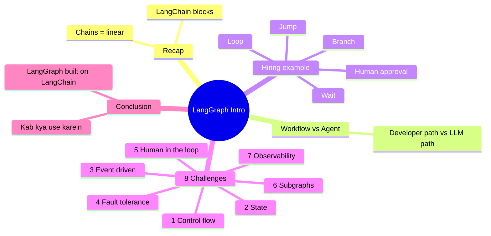

**Ek line me poora video:**
LangChain **linear** workflows ke liye bana hai. Jaise hi workflow non-linear, long-running ya human-dependent hota hai, tumhe **glue code** likhna padta hai. LangGraph isi gap ko bharta hai: workflow ko **graph** banao, **state** built-in track karo, **checkpoint** se pause/resume karo.

**Video ke 3 goals:** (1) LangGraph kyun exist karta hai, (2) LangGraph kya hai, (3) LangChain vs LangGraph kab use karein.

---

## 1. Quick recap: LangChain

Open-source library jo LLM-based apps banana simple karti hai.

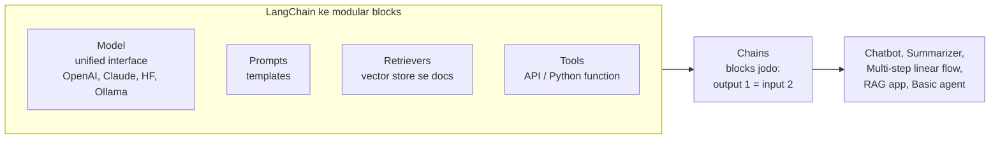

| Block | Kaam |
|---|---|
| **Model** | Kisi bhi LLM provider se baat karne ka unified interface. LLM badalna ho to code kam badalta hai |
| **Prompts** | Prompt engineering / templates |
| **Retrievers** | Vector store / knowledge base se relevant docs laana (RAG) |
| **Chains** | Components jodna, pehle ka output automatically agle ka input |
| **Tools** | LLM ko API / Python function call karne dena (jaise weather API) |

**Chain ka seedha example (multi-step linear):**

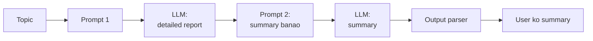

**RAG ka flow:**

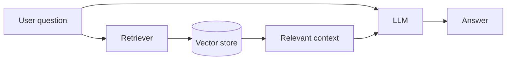

**Tool-calling agent ka example:**

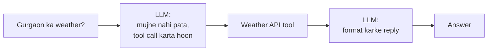

**Core limitation:** Chain = left se right, bina ruke. Yahin se saari problems shuru hoti hain.

---

## 2. Workflow vs Agent (Anthropic ka "Building Effective Agents" blog)

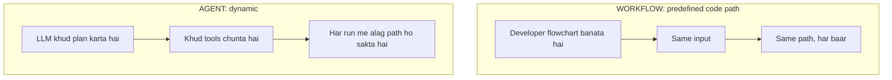

| | Workflow | Agent |
|---|---|---|
| Path kaun banata hai | **Developer** | **LLM khud** |
| Har run | Same flowchart | Alag ho sakta hai |
| Autonomy | Kam | Zyada |
| LLM use hota hai? | Haan | Haan |

> ⚠️ Video ka **Automated Hiring flowchart ek workflow hai, agent nahi**. Dono me LLM use hota hai, par yahan flowchart developer ne fix kiya hai.

---

## 3. Running example: Automated Hiring workflow

Isi ek flowchart pe poore 8 challenges samjhaye gaye. 🟡 = wait, 🟢 = human.

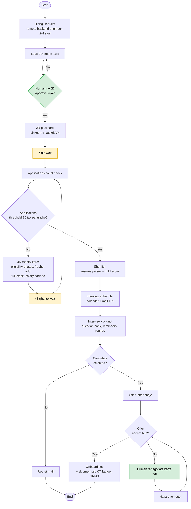

**Is flowchart me kya-kya hai:**

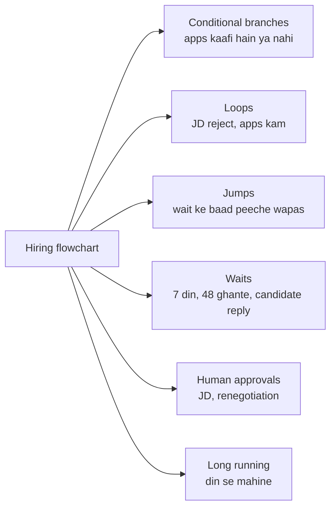

Ab dekhte hain ise LangChain me banane me kya dikkat aati hai.

---

## 4. 8 Challenges: LangChain vs LangGraph

---

### Challenge 1: Control Flow Complexity (branch, loop, jump)

**Problem:** LangChain chains linear hain, `if/else`, `while`, `goto` jaisa koi construct nahi.

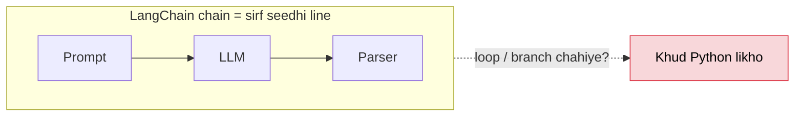

**LangChain me JD-approval loop kaise banega (glue code):**

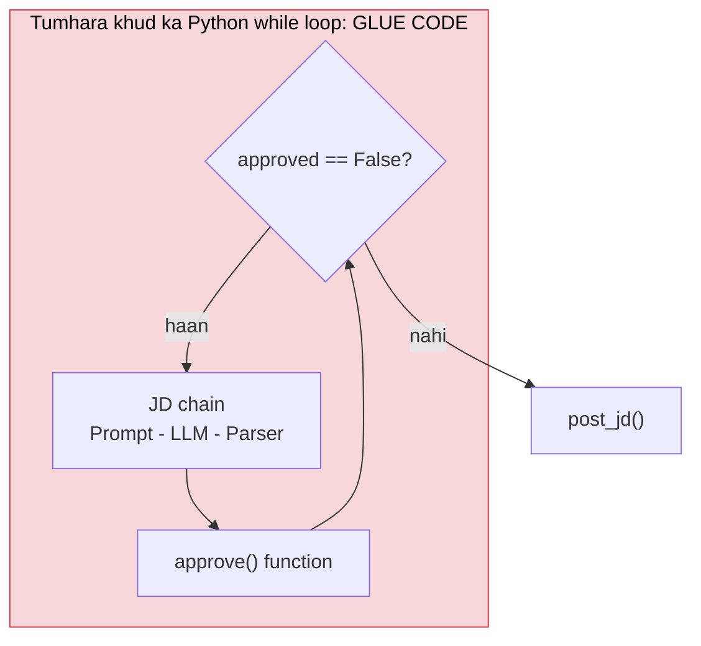

> **Glue code** = framework ke bahar likha custom Python jo logic stitch karta hai. Jitna zyada, utna maintain, debug, team-work mushkil. Ye to flowchart ka sirf **chhota hissa** tha, poore flowchart me kai loops/branches/jumps hain.

**LangGraph ka fix: workflow = graph**

| Cheez | LangGraph me |
|---|---|
| Har task | **Node** (simple Python function) |
| Control flow | **Edge** |
| Branch / loop | **Conditional edge** |
| Glue code | **Zero** |

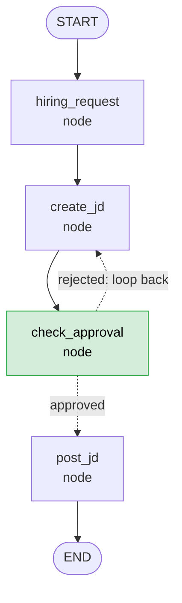

```python
from langgraph.graph import StateGraph, END

graph = StateGraph(HiringState)
graph.add_node("hiring_request", hiring_request_fn)
graph.add_node("create_jd", create_jd_fn)
graph.add_node("check_approval", check_approval_fn)
graph.add_node("post_jd", post_jd_fn)

graph.set_entry_point("hiring_request")
graph.add_edge("hiring_request", "create_jd")
graph.add_edge("create_jd", "check_approval")

# routing function ek STRING key return karta hai
def route(state) -> str:
    return "approved" if state["jd_approved"] else "rejected"

graph.add_conditional_edges(
    "check_approval", route,
    {"approved": "post_jd", "rejected": "create_jd"}   # rejected = loop back
)
graph.add_edge("post_jd", END)
app = graph.compile()
```

---

### Challenge 2: State Handling

**State** = workflow ke key-value data points ka set, jo aage badhte hue **evolve** hota hai.

**Hiring workflow ka state aur wo kaise badalta hai:**

| Fields ↓ / Node → | start | create_jd | check_approval | post_jd | monitor_apps | shortlist |
|---|---|---|---|---|---|---|
| `jd` | None | "JD text" | same | same | same | same |
| `jd_approved` | False | False | **True** | True | True | True |
| `jd_posted` | False | False | False | **True** | True | True |
| `num_applications` | 0 | 0 | 0 | 0 | **25** | 25 |
| `shortlisted` | [] | [] | [] | [] | [] | **[5 candidates]** |

**LangChain: stateless**

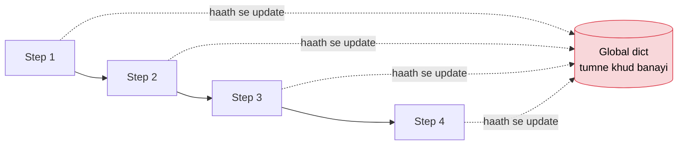
Sirf **conversational memory** (chat history) hai, wo state nahi hai. Manual dict = hectic + galti ke chances.

**LangGraph: stateful**

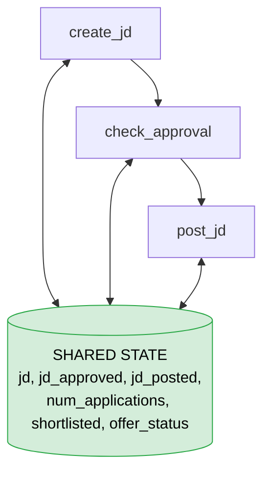

Har node: **state input me leta hai → kaam karta hai → updated state return karta hai → agla node wahi updated state paata hai.**

```python
from typing import TypedDict, Optional

class HiringState(TypedDict):
    jd: Optional[str]
    jd_approved: bool
    jd_posted: bool
    num_applications: int
    min_applications: int
    shortlisted: list
    offer_status: Optional[str]

def create_jd_fn(state: HiringState):
    return {"jd": llm.invoke(...)}   # existing state me merge hota hai
```

> 🔧 Extra: default me key **overwrite** hoti hai. List me append karna ho to **reducer** (`Annotated[list, ...]`) use hota hai.

**Yaad rakho:** LangChain = **stateless**, LangGraph = **stateful**.

---

### Challenge 3: Event-Driven Execution (pause & resume)

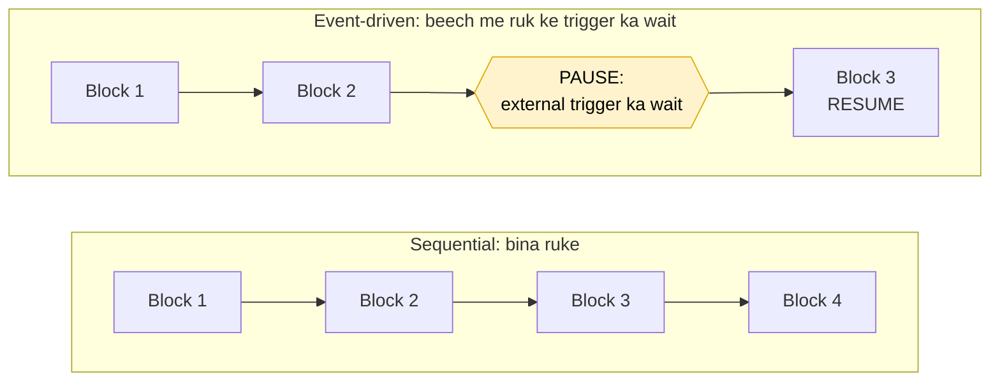

Hiring me pause kahan-kahan: **7 din wait**, **48 ghante wait**, **candidate ke offer reply ka wait**.

**LangChain:** sequential ke liye bana, pause/resume nahi hai. Workaround:

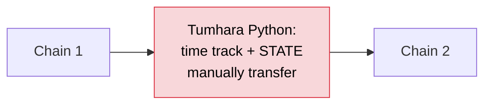

**LangGraph:** state **checkpoint** karo, pause karo, trigger pe resume.

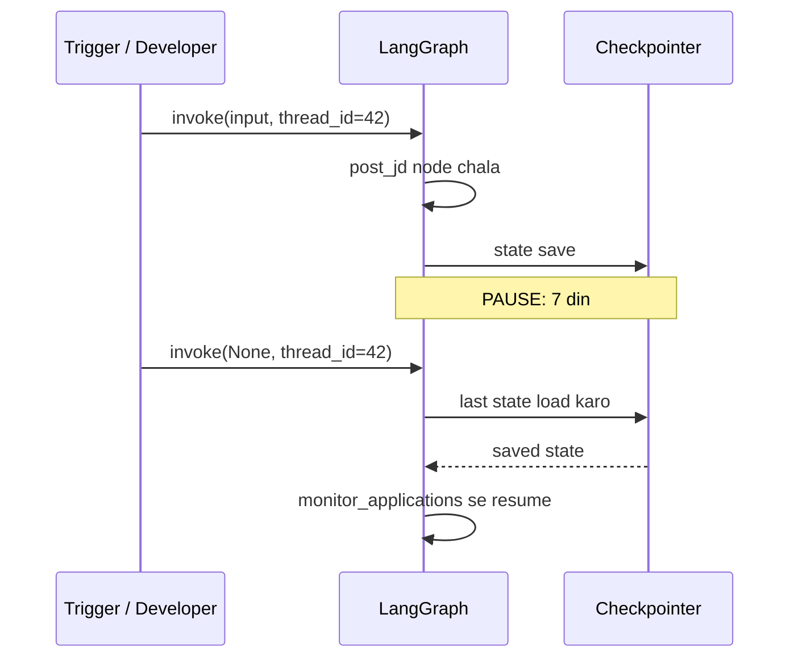

```python
from langgraph.checkpoint.memory import MemorySaver

app = graph.compile(checkpointer=MemorySaver())
config = {"configurable": {"thread_id": "hiring-run-42"}}
app.invoke({"hiring_prompt": "..."}, config=config)

# 7 din baad trigger pe:
app.invoke(None, config=config)   # last checkpoint se resume
```

> 🔧 **Checkpointer** = persistence layer jo har node ke baad state snapshot save karta hai. `MemorySaver` (dev, restart pe ud jaata hai), `SqliteSaver` / `PostgresSaver` (production). `thread_id` = ek workflow run ki unique ID, taaki kai hiring runs alag-alag chal sakein.

---

### Challenge 4: Fault Tolerance

Hiring workflow din/mahine chalta hai, isliye fault ke chances zyada.

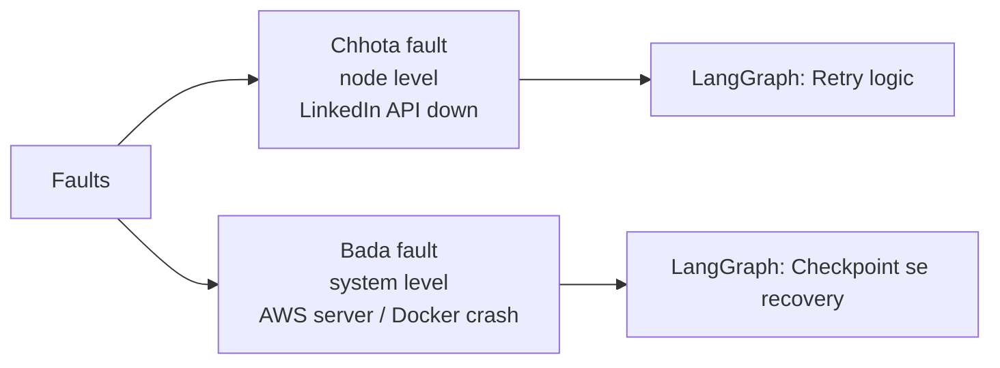

**LangChain: crash = shuru se dobara**

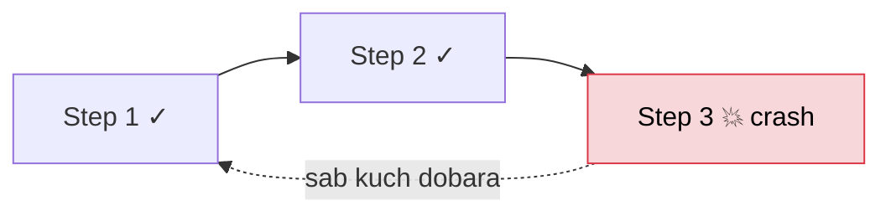

**LangGraph: jahan crash hua wahin se resume**

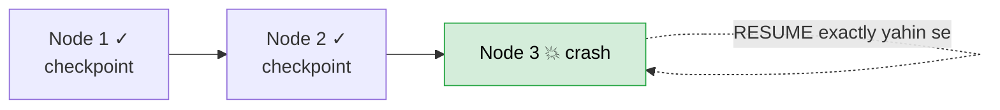

**Retry flow (chhota fault):**

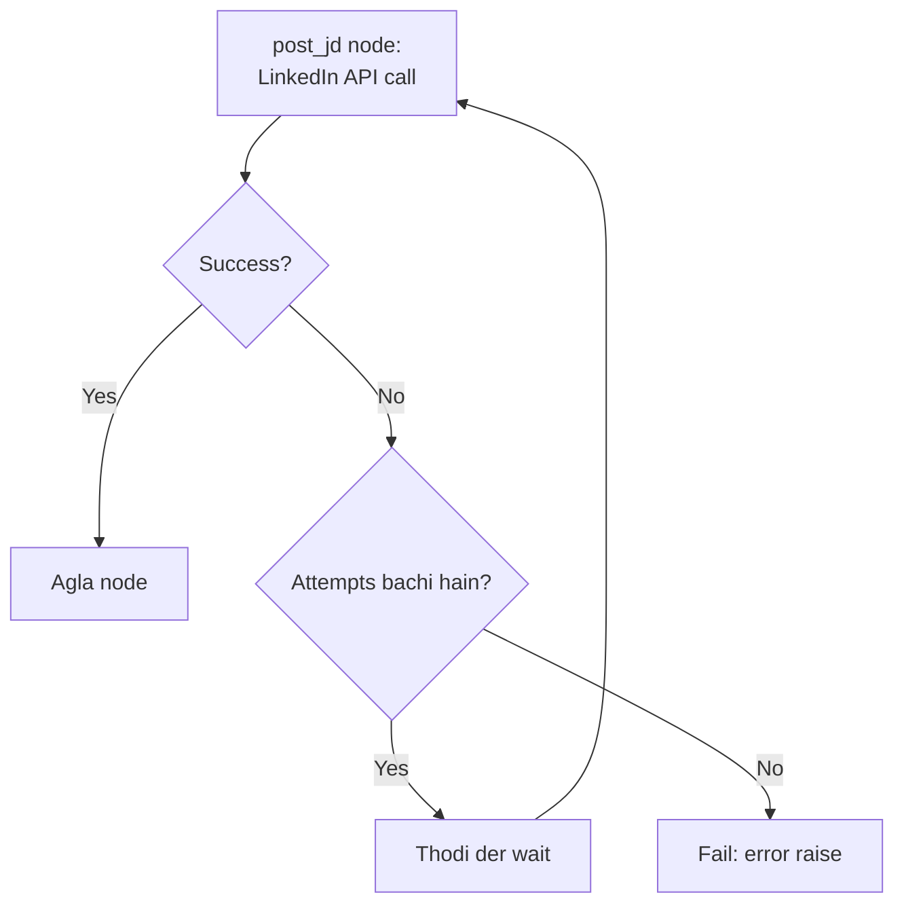

```python
from langgraph.types import RetryPolicy
graph.add_node("post_jd", post_jd_fn, retry=RetryPolicy(max_attempts=3))
```

---

### Challenge 5: Human-in-the-Loop (HITL)

Kuch steps me human ka decision zaroori hai (JD approve, renegotiation). Risky cheezon me **accountability human ki** honi chahiye.

**LangChain:** sirf short wait ke liye input maang sakta hai.

```mermaid
flowchart LR
    A["Chain chal rahi hai"] --> B["Human input ka wait<br/>24 ghante"]
    B --> C["Script idle, compute kharch,<br/>crash ka risk"]
    style C fill:#f8d7da,stroke:#dc3545,color:#000
```
Workaround: chain ko 2 hisson me todo + state manually pass karo = glue code.

**LangGraph: first-class feature, indefinite pause**

```mermaid
sequenceDiagram
    participant G as LangGraph
    participant C as Checkpointer
    participant H as Human (manager)
    G->>G: create_jd node
    G->>C: state save
    G->>H: interrupt: JD review karo
    Note over G,H: minutes, ghante, ya din ka pause. Koi compute nahi chal raha
    H-->>G: Command(resume="approve")
    G->>C: saved state load
    G->>G: jd_approved = True, aage badho
```

```python
from langgraph.types import interrupt, Command

def check_approval_node(state):
    decision = interrupt({"jd_for_review": state["jd"]})   # yahin pause
    return {"jd_approved": decision == "approve"}

# human ke jawab ke baad, dino baad:
app.invoke(Command(resume="approve"), config=config)
```

**Analogy (video wali):** Video game me stage 3 pe **save** karke band karo, kal stage 3 se hi resume. Bilkul wahi mechanism.

#### 🔗 Challenge 3, 4, 5 ek hi jad se aate hain

```mermaid
flowchart TD
    SF["Stateful execution"] --> CP(("Checkpointer<br/>har node ke baad<br/>state snapshot"))
    CP --> C3["Challenge 3<br/>Event-driven pause / resume"]
    CP --> C4["Challenge 4<br/>Fault recovery"]
    CP --> C5["Challenge 5<br/>Human-in-the-loop"]
```

---

### Challenge 6: Nested Workflows (Subgraphs) *(challenge nahi, LangGraph ka feature)*

**Subgraph** = ek graph jo kisi doosre graph ke andar **ek node ki tarah** use hota hai (encapsulation).

**Hiring me example:** "Conduct Interview" khud ek bada workflow hai, isliye alag subgraph.

```mermaid
flowchart TD
    subgraph MAIN["Main hiring graph"]
        A["schedule_interviews"] --> SG
        subgraph SG["conduct_interview: ek SUBGRAPH jo main graph me ek node hai"]
            direction LR
            q["Har candidate ke<br/>questions generate"] --> r1["Round 1"] --> e1["Evaluate"] --> r2["Round 2"] --> e2["Evaluate"] --> r3["Round 3"] --> e3["Evaluate"]
        end
        SG --> B{"Selected?"}
    end
```

**Use case 1: Multi-agent systems (self-driving car)**

```mermaid
flowchart TD
    CEO["Orchestrator agent<br/>(CEO) sabse kaam karwata hai"] --> S["Sensor agent<br/>sensors ka data process"]
    CEO --> D["Driving agent<br/>driving capability"]
    CEO --> E["Entertainment agent<br/>car ka entertainment"]
```
Har agent ek **subgraph** ho sakta hai.

**Use case 2: Reusability (ek baar banao, kai jagah lagao)**

```mermaid
flowchart LR
    AP["Approval subgraph<br/>(ek baar banaya)"]
    U1["JD approve"] --> AP
    U2["JD post approve"] --> AP
    U3["Interview schedule approve"] --> AP
```
Bilkul function ki tarah: ek baar define, kai jagah call.

```python
approval_app = approval_subgraph.compile()
main_graph.add_node("get_jd_approval", approval_app)   # compiled graph = valid node
```

> ⚠️ Sabse bada challenge: parent aur subgraph ke **alag states** ke beech communication. Video me "aage padhenge" kaha gaya. Keyword: **state key mapping / shared keys**.

**LangChain me ye concept hai hi nahi.**

---

### Challenge 7: Observability

Observability = runtime pe workflow kya kar raha hai, ise **monitor, debug, audit** karna kitna aasaan hai.

> Example: agent ne LinkedIn pe bina limit ke ads chala diye, bahut kharcha. Audit ke liye peeche jaake dekhna padega kaunse steps ki wajah se ye decision hua.

**LangChain + LangSmith = PARTIAL**

```mermaid
flowchart TD
    LS(["LangSmith<br/>monitoring tool"])
    subgraph APP["LangChain app"]
        L1["LLM call<br/>prompt, reply, tokens, time"]
        GLUE["Glue code:<br/>while loop, manual dict"]
        L2["LLM call"]
    end
    L1 --> GLUE --> L2
    LS == "dikhta hai" ==> L1
    LS == "dikhta hai" ==> L2
    LS -. "GLUE CODE nahi dikhta,<br/>loop ka kaunsa iteration?" .-> GLUE
    style GLUE fill:#f8d7da,stroke:#dc3545,color:#000
```

**LangGraph + LangSmith = FULL**

```mermaid
flowchart TD
    LS(["LangSmith"])
    subgraph G["LangGraph app: koi glue code nahi"]
        N1["Node 1"] --> N2["Node 2"] --> H["Human approval"] --> N3["Node 3"]
    end
    G == "LangGraph khud LangSmith ko batata hai" ==> LS
    LS --> T["Poori timeline:<br/>kaunsa node chala,<br/>state pehle aur baad,<br/>human kab approve kiya,<br/>messages"]
    style T fill:#d4edda,stroke:#28a745,color:#000
```

```bash
export LANGCHAIN_TRACING_V2=true
export LANGCHAIN_API_KEY=your_key
export LANGCHAIN_PROJECT=hiring-workflow
```
*(Extra: setup bas env variables hai, code change nahi.)*

---

## 5. Summary: LangChain vs LangGraph

| Challenge | LangChain | LangGraph |
|---|---|---|
| 1. Control flow (branch/loop/jump) | Glue code | Nodes + edges + conditional edges |
| 2. State | Stateless, manual dict | Stateful, state object har node ko |
| 3. Event-driven (pause/resume) | Nahi, chain todo + glue | Checkpoint + resume |
| 4. Fault tolerance | Shuru se dobara | Retry + checkpoint recovery |
| 5. Human-in-the-loop | Sirf short wait | First-class, indefinite pause |
| 6. Nested workflows | Nahi | Subgraphs (multi-agent, reuse) |
| 7. Observability | Partial (glue code invisible) | Full (LangSmith integration) |

---

## 6. LangGraph kya hai: definition

> **LangGraph** ek orchestration framework hai jo LLMs se **stateful, multi-step aur event-driven workflows** banane deta hai. Single-agent aur multi-agent, dono agentic AI apps ke liye ideal.

**Mental model: LangGraph = LLMs ke liye flowchart engine**

```mermaid
flowchart LR
    A["Steps"] --> A1["Nodes"]
    B["Connections"] --> B1["Edges"]
    C["Decision logic"] --> C1["Conditional edges"]
    D["Framework sambhalta hai"] --> D1["State, branching, looping,<br/>pause / resume, fault recovery"]
```

---

## 7. LangGraph vs LangChain: replace nahi, upar bana hai

```mermaid
flowchart TB
    subgraph LG["LangGraph = ORCHESTRATION (workflow chalana)"]
        direction LR
        n1["Node"] --> n2["Node"] --> n3["Node"]
    end
    subgraph LC["LangChain = COMPONENTS (nodes ke andar use hote hain)"]
        direction LR
        c1["Chat models"]
        c2["Prompt templates"]
        c3["Retrievers"]
        c4["Doc loaders"]
        c5["Text splitters"]
        c6["Tools"]
    end
    LG -- "nodes ke andar use karta hai" --> LC
```

LangGraph sirf LangChain ki **chain** (orchestration) ko replace karta hai, **component library ko nahi**. Dono saath chalenge.

---

## 8. Kab kya use karein (decision flowchart)

```mermaid
flowchart TD
    S(["Naya project"]) --> Q1{"Workflow simple<br/>aur linear hai?"}
    Q1 -- Haan --> LC["LangChain kaafi hai<br/>prompt chain, summarizer, basic RAG"]
    Q1 -- Nahi --> Q2{"Kya in me se kuch chahiye?<br/>conditionals / loops<br/>human-in-the-loop lambi delay<br/>multi-agent coordination<br/>async / event-driven"}
    Q2 -- Haan --> LG["LangGraph use karo<br/>components phir bhi LangChain ke"]
    Q2 -- Nahi --> LC
    style LC fill:#cfe2ff,stroke:#0d6efd,color:#000
    style LG fill:#d4edda,stroke:#28a745,color:#000
```

| **LangChain** | **LangGraph** |
|---|---|
| Simple linear workflow | Complex non-linear workflow |
| Prompt chain, summarizer, basic RAG | Conditionals / loops chahiye |
| Short-lived execution | Human-in-the-loop (lambi delay) |
| | Multi-agent coordination |
| | Async / event-driven execution |

---

## 9. Glossary

| Term | Matlab |
|---|---|
| Workflow | Developer-defined fixed path |
| Agent | LLM-decided dynamic path |
| Glue code | Framework ke bahar ka custom Python jo flow stitch kare (jitna kam, utna accha) |
| Node | Ek task (Python function) |
| Edge / Conditional edge | Control flow / branch ya loop |
| State | Evolving key-value data jis pe workflow depend karta hai |
| Stateless / Stateful | LangChain / LangGraph |
| Checkpointer | Har node ke baad state snapshot save karne wali layer (`thread_id` se keyed) |
| `interrupt()` | Graph ko human input ke liye pause karne wala primitive |
| Subgraph | Graph jo doosre graph me node banke use hota hai |
| Reducer | State field ke liye custom merge logic (append vs overwrite) |
| Observability | Runtime pe monitor / debug / audit karne ki kshamta (LangSmith) |

---

## 10. Self-test

1. Workflow vs agent me core difference? *(developer-defined path vs LLM-decided path)*
2. LangChain loops/branches natively kyun nahi kar sakta? *(chains design se linear hain, isliye glue code)*
3. LangChain stateless aur LangGraph stateful, iska kya matlab? *(LangGraph har node ko shared state deta hai jo update hoti rehti hai)*
4. Checkpointer kaunse 3 challenges ek saath solve karta hai? *(event-driven pause/resume, fault recovery, human-in-the-loop)*
5. HITL ka primitive? *(`interrupt()` + `Command(resume=...)`)*
6. Subgraph ke 2 use cases? *(multi-agent systems, reusability)*
7. LangSmith ki observability LangChain me partial kyun? *(glue code uske liye invisible)*
8. True/False: LangGraph LangChain ko replace karta hai. *(False, ye uske upar bana hai)*