# 04 — LangGraph Core Concepts
*(Agentic AI playlist, Video 4: LLM workflows, Graph/Node/Edge, State, Reducers, Execution model)*

> 📌 Har concept ka format: **📝 Notes** (likha hua, jaldi padhne ke liye) → **🗺️ Diagram** (dekhne ke liye) → **🧠 Yaad rakho** (ek line).
> Diagrams Mermaid me hain (GitHub / VS Code preview me render hote hain).

---

## ⚡ TL;DR (30 second me poora video)

| Concept | Ek line me |
|---|---|
| **LLM workflow** | Tasks ki series jisme kuch tasks LLM pe depend karte hain |
| **5 patterns** | Prompt Chaining, Routing, Parallelization, Orchestrator-Worker, Evaluator-Optimizer |
| **Node** | Ek task. Andar se sirf ek **Python function** |
| **Edge** | Node ke baad kaun sa node chalega (sequential / parallel / conditional / loop) |
| **State** | Shared + mutable data jo poore workflow me flow karta hai (**TypedDict**) |
| **Reducer** | State update ka rule: **replace / add / merge** (har key ka apna) |
| **Execution** | Define → Compile → Invoke → supersteps (message passing) → Terminate |

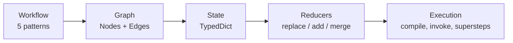

---

## 1. Recap: LangGraph kya hai

### 📝 Notes
- LangGraph = **orchestration framework**, jo **intelligent, stateful, multi-step LLM workflows** banata hai.
- Kaam: tumhare LLM workflow ko ek **graph** me convert karta hai.
  - Har **node** = workflow ka ek task (LLM call, tool call, ya decision making).
  - Har **edge** = ek task ke baad agla task kaunsa.
- Graph banane ke baad: **pehle node ko input do, graph trigger karo**, baaki nodes sahi order me apne aap chalte hain.
- Graph ke upar ke extra features:

| Feature | Matlab |
|---|---|
| Parallel execution | Ek node ke baad kai nodes ek saath |
| Loops | Peeche wale node pe wapas jana (cycles) |
| Branching | Condition ke hisaab se alag raasta |
| Memory | Tasks aur conversation record karna |
| Resumability | Breakdown ke baad wahin se resume |

### 🗺️ Diagram
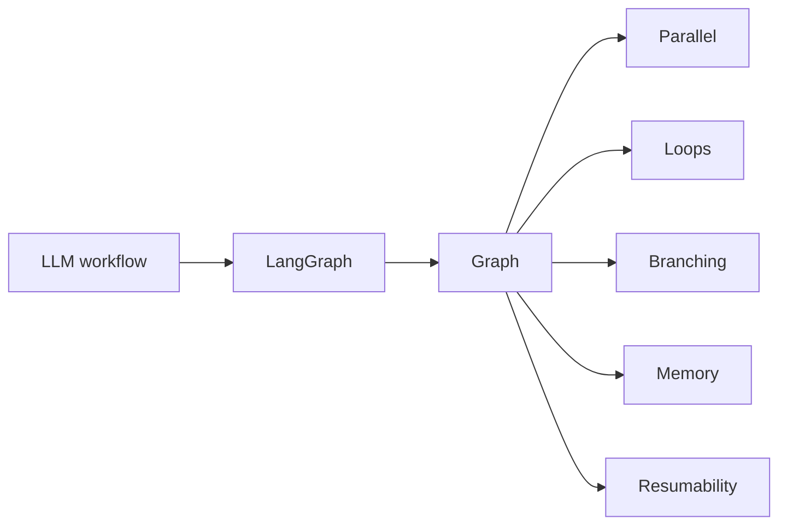

### 🧠 Yaad rakho
LangGraph = **workflow ko flowchart (graph) me convert karke chalane wala engine.**

---

## 2. LLM Workflows

### 📝 Notes
- **Workflow** = tasks ki series jo **sahi order** me chalti hai, ek **goal** achieve karne ke liye. (Eg: hiring = JD → post → shortlist → interview → onboarding.)
- **LLM workflow** = wo workflow jisme **kai tasks LLM pe depend** karte hain: prompting, reasoning, tool calling, memory access, decision making.
- Workflow ka shape: **linear, parallel, branched ya looped** ho sakta hai.
- Har app ka workflow alag hota hai, par kuch **common patterns** baar-baar milte hain. Ye 5 hain.

> 🔧 Ye 5 patterns Anthropic ke blog **"Building Effective Agents"** se hain.

### 🗺️ Diagram
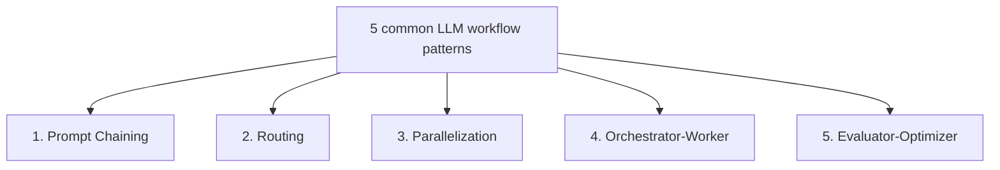

### 🧠 Yaad rakho
**Workflow** = tasks ki series. **LLM workflow** = jisme kuch tasks LLM karta hai.

---

### Pattern 1: Prompt Chaining

#### 📝 Notes
- LLM ko **kai baar, series me** call karte ho. Ek ka output agle ka input.
- **Kab use:** jab ek **complex task ko sub-tasks me todna** ho.
- Beech me **check (gate)** laga sakte ho ki process sahi chal raha hai ya nahi.
- **Example:** user topic deta hai → LLM 1 **outline** banata hai → check: **report 5000 words se zyada to nahi** (zyada ho to exit) → LLM 2 **detailed report** likhta hai.

#### 🗺️ Diagram
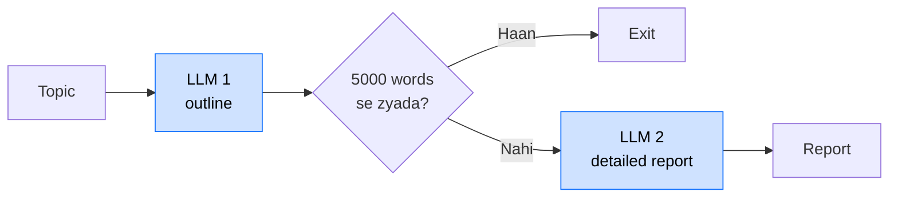

#### 🧠 Yaad rakho
**Seedhi line me LLM calls + beech me gate.**

---

### Pattern 2: Routing

#### 📝 Notes
- Ek **router LLM** task ko samajhta hai aur **decide karta hai ki kaun execute karega**.
- Router = **decision maker**: kaunsa LLM is query ko solve karne me sabse capable hai.
- **Example (customer support bot):** query aayi → router dekhta hai:
  - **Refund** wali hai → Refund LLM
  - **Technical doubt** → Tech LLM
  - **Sales** wali → Sales LLM

#### 🗺️ Diagram
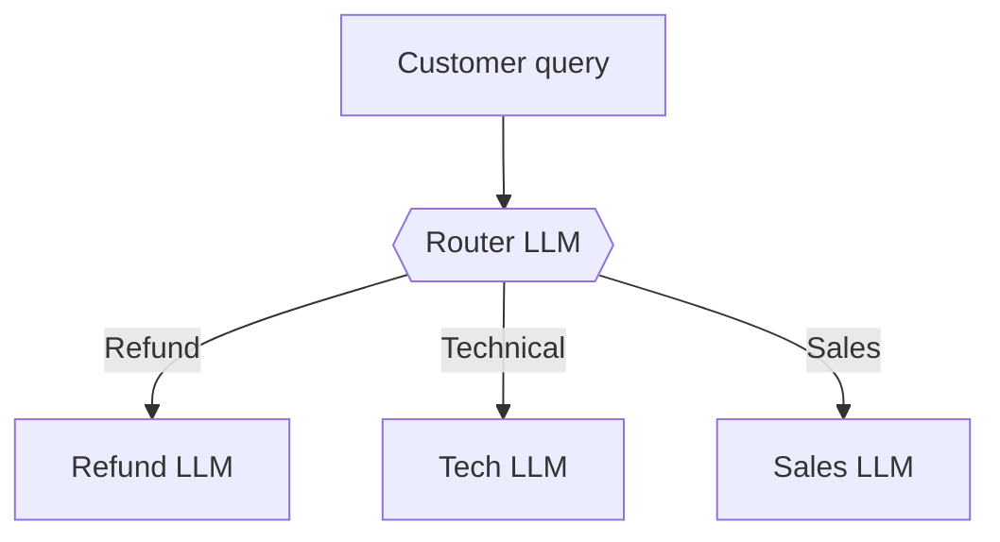

#### 🧠 Yaad rakho
**Ek LLM sirf raasta batata hai, kaam doosre karte hain.**

---

### Pattern 3: Parallelization

#### 📝 Notes
- Task ko **kai independent sub-tasks** me todo, sabko **ek saath** chalao, phir results **merge** karke final outcome nikalo.
- Sub-tasks ek doosre pe **depend nahi** karte, isliye parallel chal sakte hain.
- Sub-tasks ka **nature pehle se fixed** hota hai.
- **Example (YouTube content moderation):** video live karne se pehle 3 checks ek saath:
  1. Community guidelines follow ho rahi hain?
  2. Misinformation to nahi?
  3. Sexual content to nahi?
  Teeno pass → **live**. Koi fail → **flag**.

#### 🗺️ Diagram
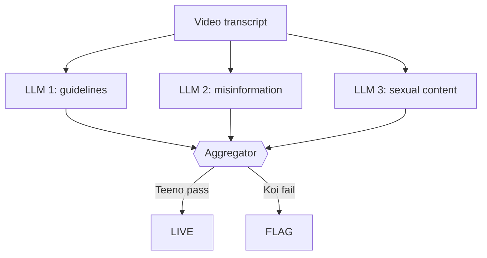

#### 🧠 Yaad rakho
**Fixed sub-tasks + ek saath + aggregate.**

---

### Pattern 4: Orchestrator-Worker

#### 📝 Notes
- Parallelization jaisa hi (task kai parallel sub-tasks me), par yahan sub-tasks ka **nature pehle se nahi pata**, wo **dynamically** decide hota hai.
- **Orchestrator LLM** input query dekhta hai aur **har worker LLM ko alag task assign** karta hai.
- **Example (research assistant):**
  - Query **scientific / technical** hai → worker ko bolo **Google Scholar** pe search kare.
  - Query **social / political** hai → worker ko bolo **Google News** pe search kare.
  - Workers parallel kaam karte hain, end me results **aggregate** hote hain.

#### 🗺️ Diagram
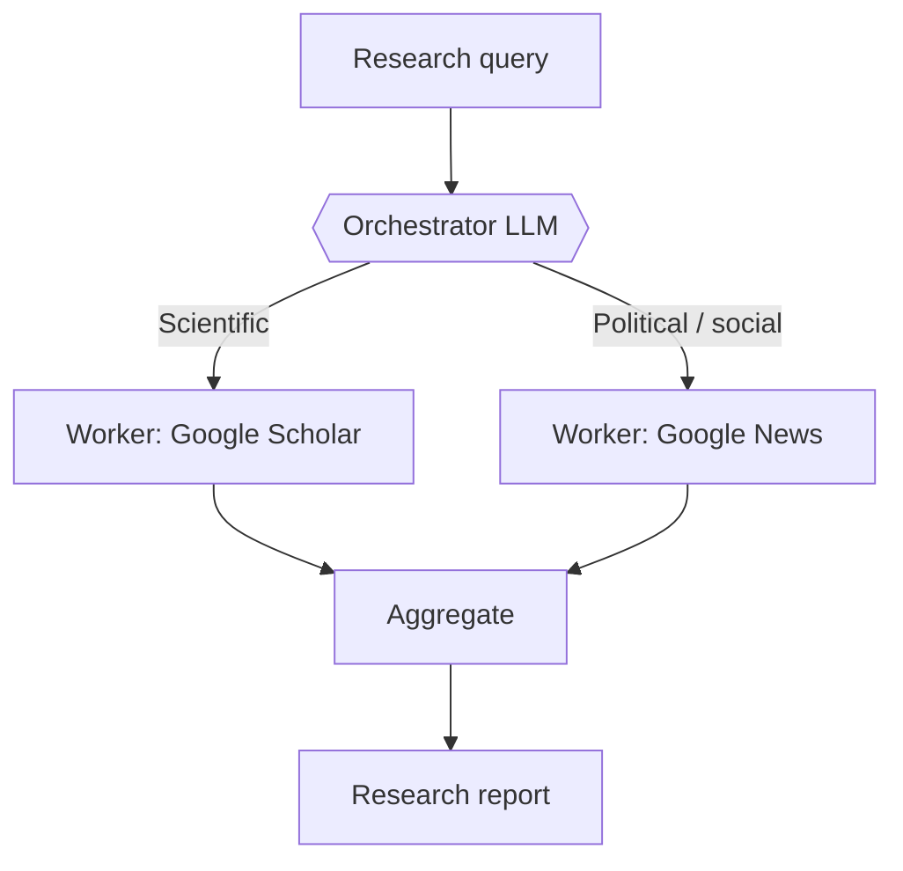

#### 🧠 Yaad rakho
**Sub-tasks input ke hisaab se badalte hain. Manager (orchestrator) har baar naya kaam baantta hai.**

#### ⚖️ Parallelization vs Orchestrator-Worker

| | Parallelization | Orchestrator-Worker |
|---|---|---|
| Sub-tasks pehle se pata? | **Haan, fixed** | **Nahi, runtime pe dynamic** |
| Example | YouTube: hamesha wahi 3 checks | Research: query ke hisaab se Scholar ya News |
| Kaun decide karta hai | Developer | Orchestrator LLM |

---

### Pattern 5: Evaluator-Optimizer

#### 📝 Notes
- Aise tasks jo **ek baar me perfectly nahi hote** (email, blog, poem, story). Creative kaam hai, **iteration lagta hai** (writer draft likhta hai, kami dekhta hai, feedback leke dobara likhta hai).
- Do LLMs:
  - **Generator LLM**: solution banata hai.
  - **Evaluator LLM**: ek **concrete criteria** pe solution ko **accept ya reject** karta hai. Reject karte waqt **feedback** bhi deta hai.
- Reject hone par Generator feedback leke **naya solution** banata hai. **Loop tab tak** jab tak evaluator satisfy na ho.
- *(Video me kaha: loops padhane ke baad ye workflow bana ke dikhayenge.)*

#### 🗺️ Diagram
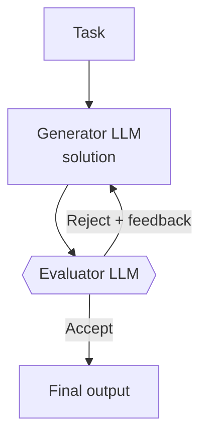

#### 🧠 Yaad rakho
**Generate → evaluate → feedback → dobara generate, jab tak accept na ho.**

---

### 📋 5 patterns ek table me

| # | Pattern | Kab use | Example |
|---|---|---|---|
| 1 | Prompt Chaining | Complex task ko steps me todna | Topic → outline → report |
| 2 | Routing | Query ke type ke hisaab se alag handler | Support: refund / tech / sales |
| 3 | Parallelization | Fixed independent checks ek saath | YouTube moderation |
| 4 | Orchestrator-Worker | Dynamic sub-tasks | Research assistant |
| 5 | Evaluator-Optimizer | Iteration se quality sudharni | Email / blog draft |

---

## 3. Graph, Node & Edge

> Teacher ke mutabik **LangGraph ka sabse important core concept.**

### 📝 Notes
- LangGraph kisi bhi LLM workflow ko **graph** me convert karta hai.
- **Node** = workflow ka **ek single task**. Andar se **sirf ek Python function**, aur kuch nahi.
- **Edge** = batata hai ki ek node ke baad **agla kaunsa node** chalega.
- **Nodes = kya karna hai. Edges = kab / agla kya.**
- Graph = **Python functions ka set, edges se interconnected.**

**Edges 4 tarah ke ho sakte hain:**

| Type | Matlab |
|---|---|
| **Sequential** | Ek ke baad ek |
| **Parallel** | Ek saath kai nodes |
| **Conditional** | Condition ke hisaab se branching (is raaste ya us raaste) |
| **Looping** | Peeche wale node pe wapas |

### 🗺️ Diagram: edges ke 4 type
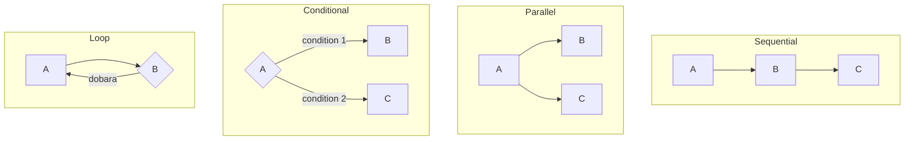

### Worked example: UPSC essay practice website

#### 📝 Notes (problem)
- Website UPSC aspirants ko **essay practice** karwati hai.
- Flow: **topic generate** → user **essay likhta hai** → essay **3 criteria** pe evaluate → **score /15** → threshold (maan lo **10**) se upar ho to **congratulate**, nahi to **feedback** + dobara likhne ka option.
- 3 criteria (har ek **/5**, total **/15**):
  - **Clarity of thought**
  - **Depth of analysis** (fact check wagairah)
  - **Language** (vocabulary, grammar, tone)

**Graph banane ka tareeka:**
1. Pehle high-level goal ko **actionable steps** me todo (copy-pen pe): topic generate, essay collect, evaluate, results aggregate, feedback, retry.
2. Phir usi flow ko LangGraph me **graph** ki tarah represent karo.

#### 🗺️ Diagram
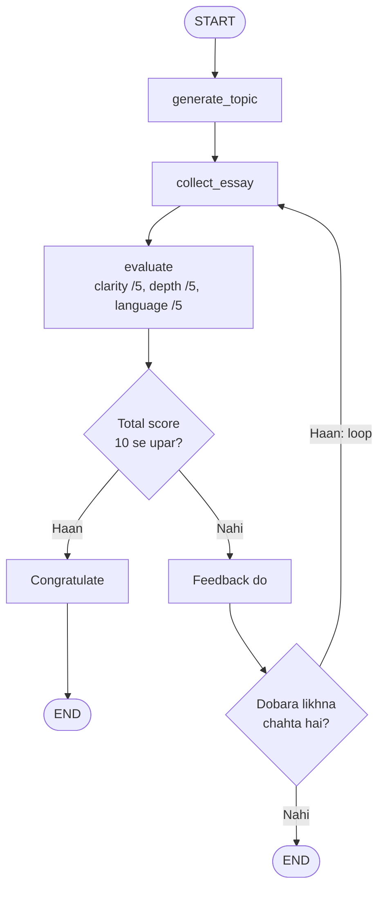

#### 🔧 Code (extra, video me conceptual tha)
```python
from langgraph.graph import StateGraph, END

graph = StateGraph(EssayState)
graph.add_node("generate_topic", generate_topic_fn)
graph.add_node("collect_essay", collect_essay_fn)
graph.add_node("evaluate", evaluate_fn)

graph.set_entry_point("generate_topic")
graph.add_edge("generate_topic", "collect_essay")
graph.add_edge("collect_essay", "evaluate")

def route_after_eval(state) -> str:
    if state["total_score"] >= 10:
        return "pass"
    return "retry" if state["wants_retry"] else "fail"

graph.add_conditional_edges(
    "evaluate", route_after_eval,
    {"pass": END, "fail": END, "retry": "collect_essay"}
)
app = graph.compile()
```

### 🧠 Yaad rakho
**Node = Python function (kya). Edge = flow (kab). Ye dono milke sequential, parallel, branching, loop, sab express karte hain.**

---

## 4. State

### 📝 Notes
- Koi bhi workflow chalane ke liye kuch **data pieces** chahiye hote hain, aur wo **chalte-chalte badalte** hain. Unhi sabko milakar **State** kehte hain.
- Definition: **State = shared memory jo tumhare workflow me flow karti hai. Nodes ke beech pass hone wala saara data isme hota hai.**
- UPSC workflow ka state: `topic`, `essay_text`, `clarity_score`, `depth_score`, `language_score`, `total_score`.
- Graph banane se **pehle** LangGraph kehta hai: **state define karo** (key-value pairs).

**2 khaasiyat:**

| Khaasiyat | Matlab |
|---|---|
| **Shared** | Har node ko poori state ka access |
| **Mutable** | Koi bhi node state me changes kar sakta hai |

**Kaise kaam karta hai (har node ke saath):**
1. Node ko **poori state input** me milti hai.
2. Node apna kaam karta hai.
3. Node state me **changes** karta hai.
4. Wahi **updated state agle node** ko jaati hai.

**Code me:** ek **TypedDict** (special dictionary, Python ki class). Pydantic bhi chalta hai, par mostly TypedDict.

### State evolve kaise hoti hai (UPSC)

| Key ↓ / Node → | generate_topic | collect_essay | evaluate |
|---|---|---|---|
| `topic` | **"Climate change"** | same | same |
| `essay_text` | khali | **"essay text..."** | same |
| `clarity / depth / language` | 0 | 0 | **4 / 3 / 5** |
| `total_score` | 0 | 0 | **12** |

### 🗺️ Diagram
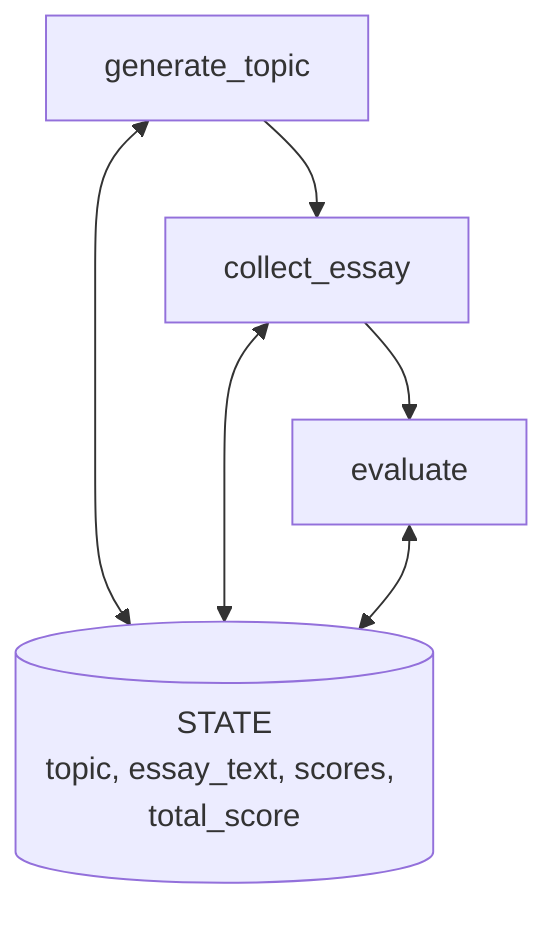

### 🔧 Code
```python
from typing import TypedDict

class EssayState(TypedDict):
    topic: str
    essay_text: str
    clarity_score: float
    depth_score: float
    language_score: float
    total_score: float
    wants_retry: bool
```
> Har node poori state leta hai aur **sirf wo fields ka dict return** karta hai jo badalne hain. LangGraph use state me **merge** karta hai.

### 🧠 Yaad rakho
**State = shared + mutable dictionary (TypedDict) jo evolve hoti rehti hai.**

---

## 5. Reducers

### 📝 Notes
- Reducer state ki **mutable** property se closely connected hai.
- **Default behavior:** node kisi key ke liye value return kare to LangGraph **purani value ko hata ke naya rakh deta hai (replace)**.
- **Reducer define karta hai ki nodes ke updates shared state par kaise apply honge: replace, add (append) ya merge.** **Har key ka apna reducer** ho sakta hai.

**Kab replace theek, kab nahi:**

| Example | Replace chalega? | Kyun |
|---|---|---|
| Calculator (`result`: 11 → 22) | ✅ Haan | Purana result chahiye nahi |
| Chatbot (`messages`) | ❌ Nahi | Purane messages chahiye warna LLM bhool jaata hai |
| UPSC (`essay_text`) agar past essays dekhne hain | ❌ Nahi | Student apna improvement dekhna chahta hai |

### Example A: Calculator (replace theek)
1. State: `first_number`, `second_number`, `result`.
2. Node 1: user ne **5** aur **6** diya.
3. Node 2: sum, `result = 11`.
4. Node 3: **2 se multiply**, `result = 22` (**11 replace ho gaya**). Yahan theek hai.

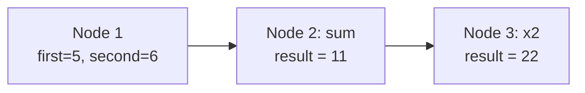

### Example B: Chatbot (replace BREAK karta hai)
State me sirf `messages`. Human aur LLM loop me baat kar rahe hain.
1. Human: **"Hi, my name is Nitish"** → `messages` me ye.
2. LLM: **"Hi, how can I help you?"** → **replace**, naam wala message **gaya**.
3. Human: **"Can you tell me my name?"** → phir replace.
4. LLM ko **naam kabhi pata nahi chalega**, kyunki wo message state se **erase** ho chuka.

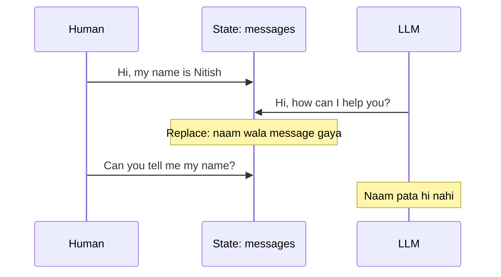

**Fix:** replace ki jagah **har naya message list me ADD** karo.

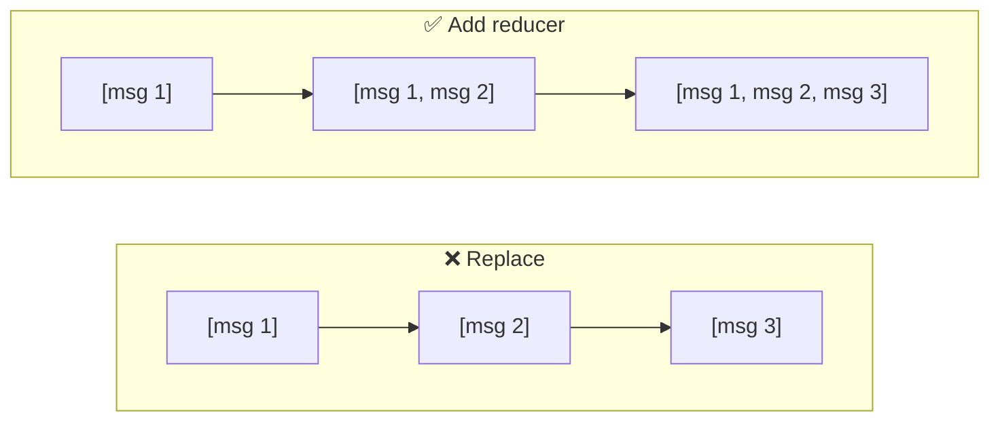

### Example C: UPSC (past essays)
Student ne **3 baar essay** likha. Replace karoge to sirf teesra bachega. **Add reducer** lagao to **pehla, doosra, teesra sab** safe, aur student apna **improvement** dekh sakta hai.

### 🔧 Code (extra)
```python
from typing import TypedDict, Annotated
from operator import add
from langgraph.graph.message import add_messages   # chat ke liye built-in reducer

class ChatState(TypedDict):
    messages: Annotated[list, add_messages]   # add hota hai, replace nahi

class EssayState(TypedDict):
    essay_attempts: Annotated[list, add]      # generic add reducer
    total_score: float                        # annotation nahi = default replace
```
> `add_messages` plain list-append se smart hai: message **ID se de-duplication** aur existing message **update** bhi handle karta hai.

### 🧠 Yaad rakho
- **Reducer = update ka rule: replace / add / merge.** Har key ka apna.
- **Parallel workflows** me sabse zyada kaam aata hai (kai nodes ek hi key ko ek saath update karte hain). Coding wale video me dikhayenge.

---

## 6. Execution Model

### 📝 Notes
- LangGraph ka execution model **Google Pregel** se inspired hai (Google ka bade scale ka graph-processing system).
- Do phase: **(1) Graph Definition + Compile**, **(2) Execution**.

#### Phase 1: Definition + Compile
1. **Define:** 3 cheezein banao: **nodes**, **edges**, **state** (TypedDict).
2. **Compile:** `graph.compile()` check karta hai ki **structure logically sahi hai**. Jaise koi node aisa to nahi jo kisi se connected hi nahi. Aise node ko **orphan node** kehte hain (compile pe pakda jaata hai).

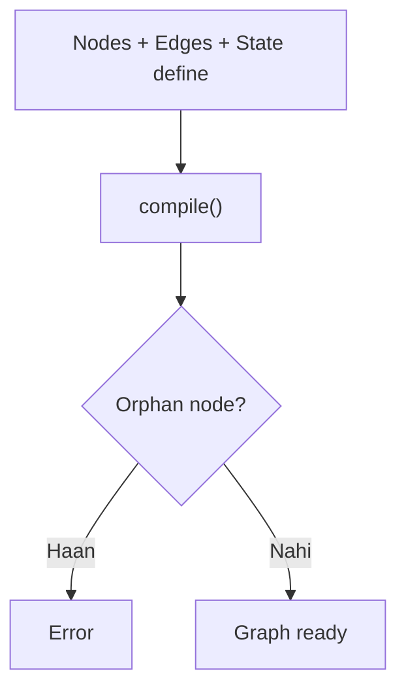

#### Phase 2: Execution (step by step)
1. **Invocation:** `app.invoke(initial_state)`. Initial state **pehle node** ko jaati hai.
2. **Activation:** wo node **activate** hota hai, yaani uska **Python function call** hota hai.
3. Node kaam karke state pe **partial update** karta hai (sirf kuch fields).
4. **Message passing:** updated state **edge ke through agle node** tak jaati hai.
5. Agla node activate hota hai, wahi cycle dohrati hai.
6. **Termination:** jab **koi active node nahi** aur **edges me koi message pass nahi ho raha**.

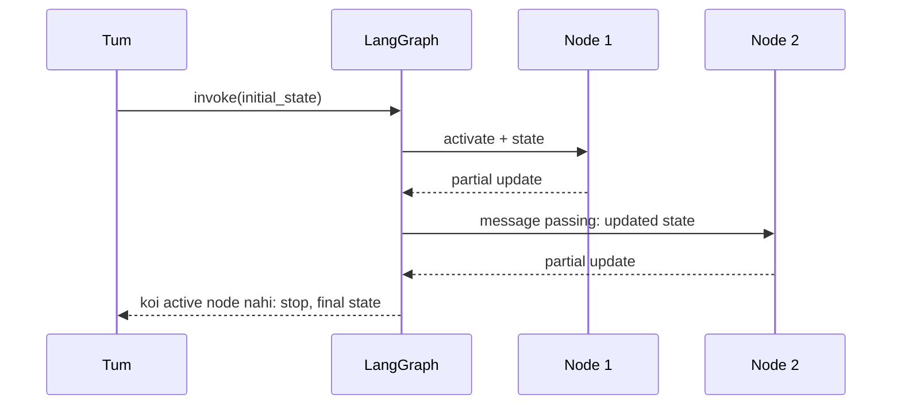

> ⚠️ Tum **manually** node 1, phir node 2 call nahi karte. Sirf **ek baar `invoke()`**, baaki sab (message passing + scheduling) LangGraph andar se karta hai.

#### Superstep: "step" nahi, "superstep" kyun?
- Ek **round** ko **superstep** kehte hain.
- Kyun? Kyunki ek round me **ek se zyada nodes parallel** chal sakte hain. Agar ek node ke baad **3 parallel nodes** hain, to wo ek hi round me **3 steps ek saath** hain. Isse sirf "step" kehna sahi nahi.
- **1 superstep = 1 step ya kai parallel steps.**
- Parallel nodes ke updates **reducer** se state me merge hote hain.

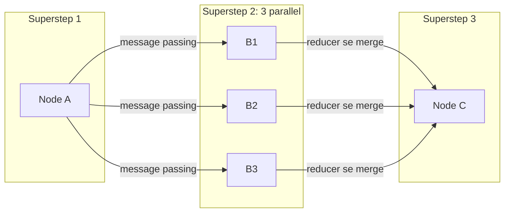

### Terminology

| Term | Matlab |
|---|---|
| Graph definition | Nodes, edges, state declare karna |
| Compile | Structure validate karna (orphan node pakadna) |
| Invocation | Initial state first node ko dena |
| Activation | Node ka Python function call hona |
| Partial update | Node state ke sirf kuch fields badalta hai |
| Message passing | Updated state ko edge se agle node tak bhejna |
| Superstep | Ek round (1 ya kai parallel nodes) |
| Termination | Koi active node nahi + edges me message nahi |

### 🧠 Yaad rakho
**Define → Compile → Invoke → (activate, partial update, message passing) × supersteps → Terminate.**

---

## 7. Poora video ek hi flow me

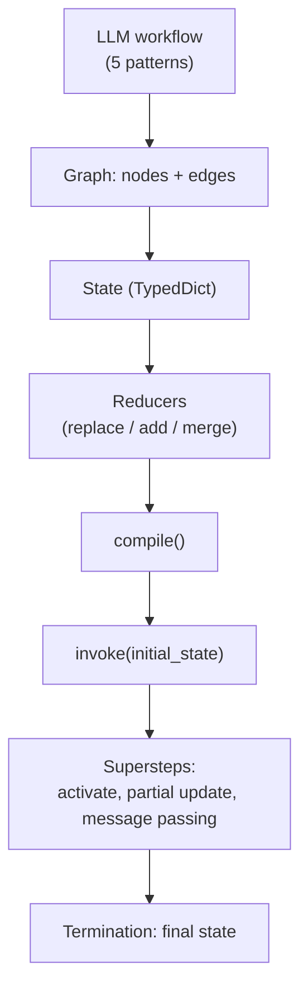

---

## 8. Glossary

| Term | Matlab |
|---|---|
| Workflow | Goal ke liye tasks ki series |
| LLM workflow | Jisme kai tasks LLM pe depend |
| Prompt chaining | LLM calls ki series + gate |
| Routing | Router LLM decide kare kaun handle karega |
| Parallelization | Fixed sub-tasks ek saath |
| Orchestrator-Worker | Dynamic sub-tasks, orchestrator baante |
| Evaluator-Optimizer | Generate, evaluate, feedback loop |
| Node | Ek task (Python function) |
| Edge | Kab / agla kya (flow) |
| State | Shared, mutable data (TypedDict) |
| Reducer | State update ka rule: replace / add / merge |
| `add_messages` | Chat ke liye built-in add reducer |
| Orphan node | Kisi se connected nahi, compile pe error |
| Superstep | Execution ka ek round |
| Pregel | Google ka graph-processing system (inspiration) |

---

## 9. Self-test

1. LLM workflow kya hai? *(jisme kai tasks LLM pe depend karte hain)*
2. Parallelization vs Orchestrator-Worker ka ek line me fark? *(sub-tasks pehle se fixed vs runtime pe dynamic)*
3. Evaluator-Optimizer ka loop kab rukta hai? *(evaluator accept kar le)*
4. Node andar se kya hai? *(Python function)*
5. State ki 2 khaasiyat? *(shared, mutable)*
6. State kis se banti hai? *(TypedDict ya Pydantic)*
7. Chatbot me default replace kyun fail hota hai? *(naya message purane ko mita deta hai, naam bhool jaata hai)*
8. Chat ka built-in reducer? *(`add_messages`)*
9. `compile()` kya check karta hai? *(structure sahi hai, orphan node nahi)*
10. "Superstep" kyun? *(ek round me kai nodes parallel chal sakte hain)*
11. Execution kab rukta hai? *(koi active node nahi + edges me message nahi)*
12. Execution model kisse inspired hai? *(Google Pregel)*