# 04 — LangGraph Core Concepts
*(Agentic AI playlist, Video 4: LLM workflows, Graph/Nodes/Edges, State, Reducers, Execution model)*

> 📌 Diagrams **Mermaid** me hain (GitHub, VS Code Mermaid preview, Obsidian me render hote hain).
> Legend: 🟢 hara = start / success, 🟡 peela = decision / loop, 🔴 laal = problem, 🔵 neela = LLM call.
> 🔧 = extra context jo video me nahi tha, par samajhne me kaam aata hai.

---

## 0. Video ka bird's-eye view

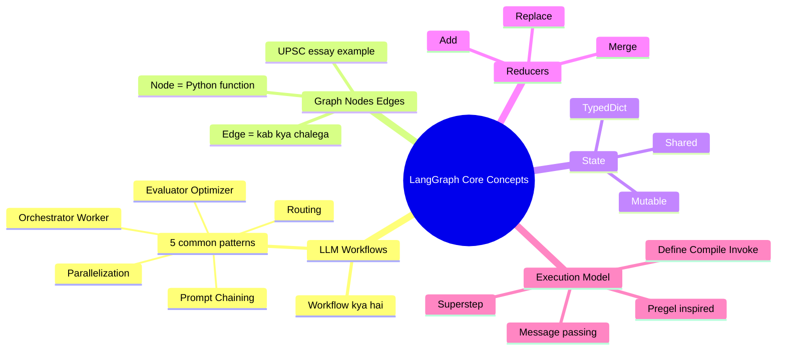

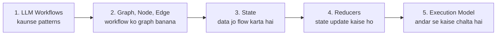

---

## 1. Quick recap: LangGraph kya hai

> LangGraph = **orchestration framework** jo intelligent, stateful, multi-step LLM workflows banane deta hai.

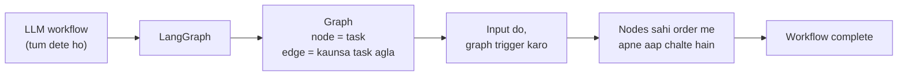

**Graph ke saath extra features:**

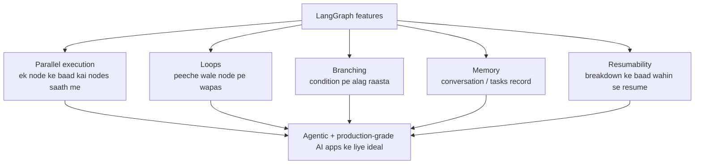

---

## 2. LLM Workflows

**Workflow** = tasks ki series jo sahi order me chalti hai, ek goal achieve karne ke liye.
*(Eg: hiring = JD banao → post karo → shortlist → interview → onboarding)*

**LLM workflow** = aisa workflow jisme **kai tasks LLM pe depend** karte hain (prompting, reasoning, tool calling, memory access, decision making).

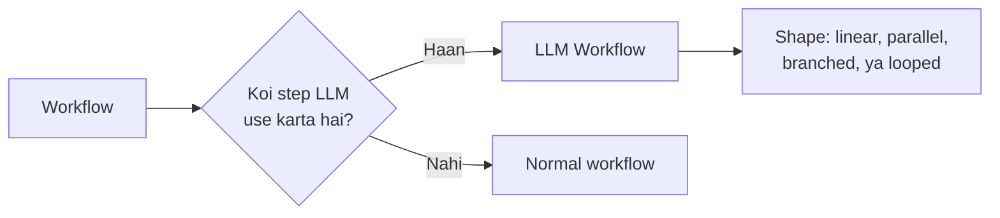

> Har application ka apna workflow hota hai, par kuch **common patterns** baar-baar milte hain. Ye 5 hain:

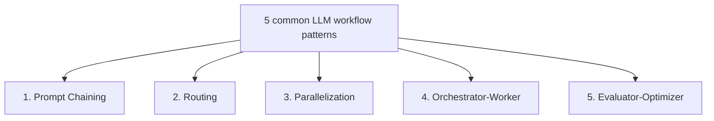

> 🔧 Ye 5 patterns Anthropic ke blog **"Building Effective Agents"** se hain (wahi blog jo Video 3 me workflow vs agent ke liye tha).

---

### Pattern 1: Prompt Chaining

LLM ko **kai baar, series me** call karte ho. Complex task ko sub-tasks me todo, aur beech me **check (gate)** laga sakte ho.

**Example:** topic se detailed report.

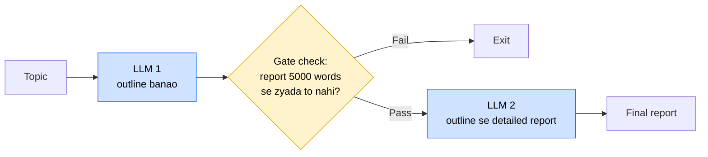

**Kab:** jab complex task ko sub-tasks me todna ho aur beech me quality checks chahiye.

---

### Pattern 2: Routing

Ek **router LLM** task samajhta hai aur decide karta hai ki **kaun** isse handle karega.

**Example:** customer support chatbot.

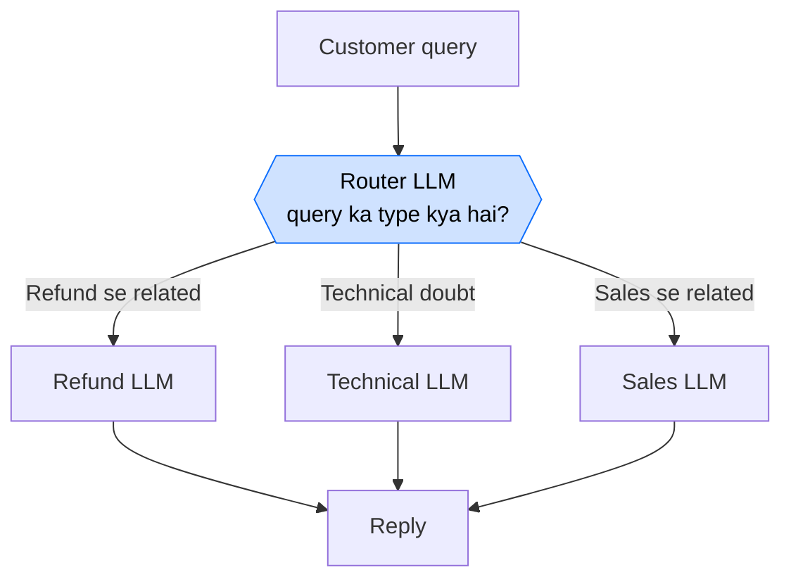

Router LLM = **decision maker**, jo batata hai in teeno me se kaun query solve karne me sabse capable hai.

---

### Pattern 3: Parallelization

Task ko **independent sub-tasks** me todo, **ek saath (parallel)** chalao, aur results **merge/aggregate** karo.

**Example:** YouTube content moderation. Video live karne se pehle 3 checks:

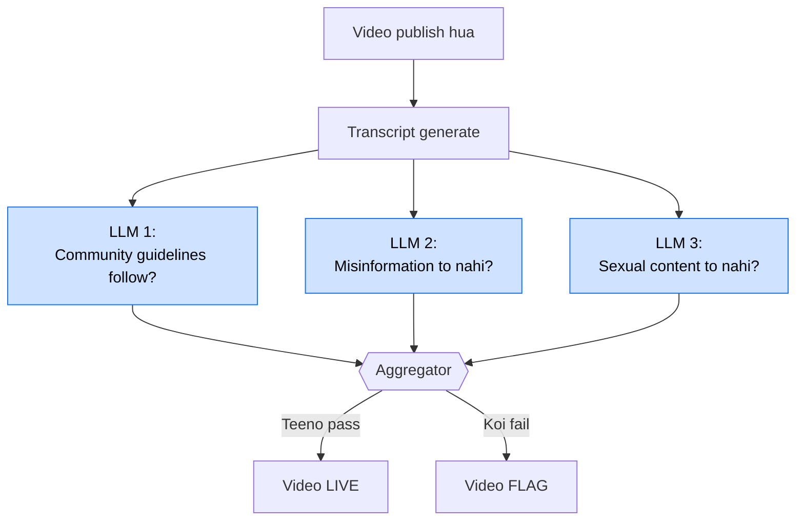

Ye teeno checks **ek doosre pe depend nahi karte**, isliye parallel chal sakte hain. Sub-task ke **types pehle se fixed** hain.

---

### Pattern 4: Orchestrator-Worker

Parallelization jaisa hi (kai sub-tasks parallel), par **sub-tasks pehle se nahi pata**, **runtime pe dynamically** decide hote hain.

**Example:** research assistant. Query ke hisaab se alag jagah search.

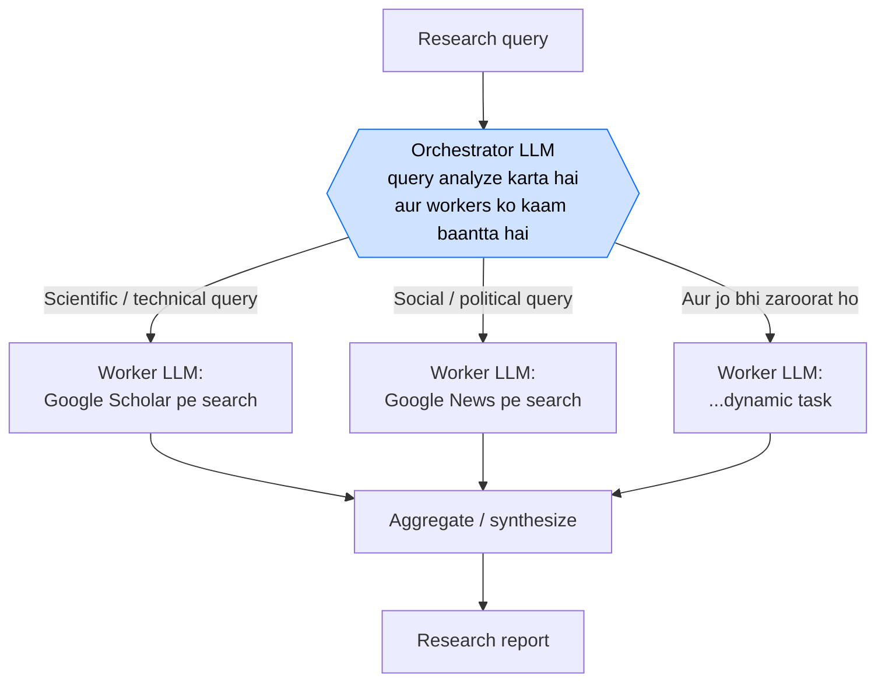

#### ⚖️ Parallelization vs Orchestrator-Worker (aksar confuse hota hai)

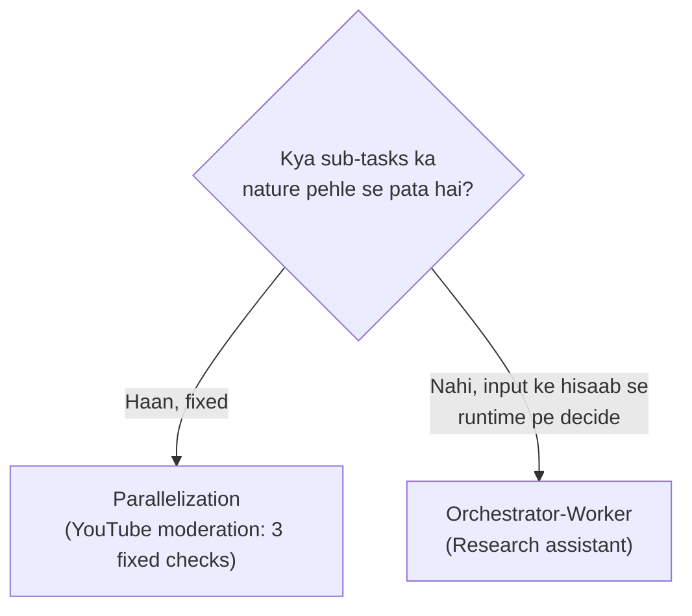

---

### Pattern 5: Evaluator-Optimizer

Aise tasks jo **ek baar me perfect nahi hote** (email, blog, poem, story). Creative kaam me iteration lagta hai, jaise writer draft likhta hai, kami dekhta hai, feedback leke dobara likhta hai.

Do LLMs: **Generator** (solution banata hai) aur **Evaluator** (criteria pe jaanchta hai).

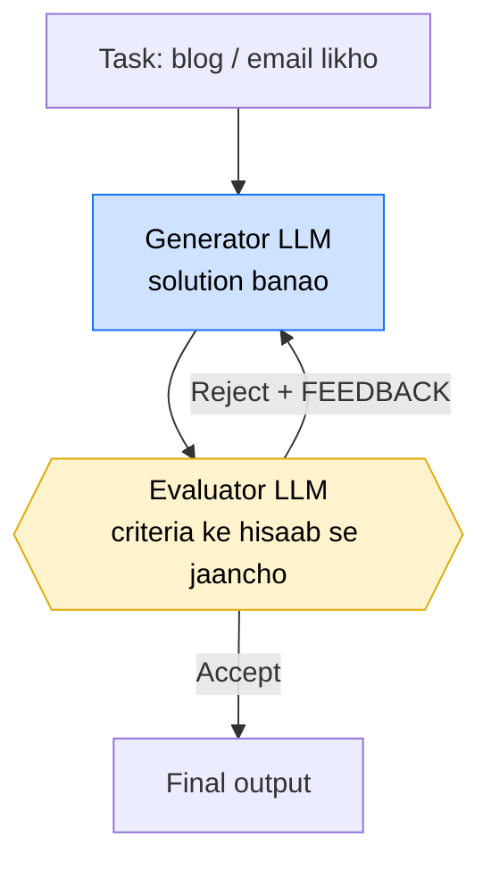

Ye loop **tab tak** chalta hai jab tak evaluator satisfy na ho jaye. *(Video me kaha: loops padhane ke baad ye workflow bana ke dikhayenge.)*

---

### 📋 5 patterns ek nazar me

| # | Pattern | Kya karta hai | Example |
|---|---|---|---|
| 1 | **Prompt Chaining** | LLM calls ki fixed series, beech me gate | Topic → outline → report, word-count check |
| 2 | **Routing** | Router LLM decide karta hai kaun handle kare | Support query → refund / tech / sales |
| 3 | **Parallelization** | Fixed independent sub-tasks ek saath, phir aggregate | YouTube content moderation |
| 4 | **Orchestrator-Worker** | Sub-tasks runtime pe dynamic, parallel, aggregate | Research assistant |
| 5 | **Evaluator-Optimizer** | Generate → evaluate → feedback → loop | Email / blog draft |

---

## 3. Graphs, Nodes & Edges

> Teacher ke mutabik **LangGraph ka sabse important core concept.**

### Worked example: UPSC essay practice website

Flow: topic generate → user essay likhe → 3 criteria pe evaluate → score /15 → score kaafi hai to congratulate, nahi to feedback + retry ka option.

**Step 1: pehle high-level goal ko actionable steps me todo (copy-pen pe):**

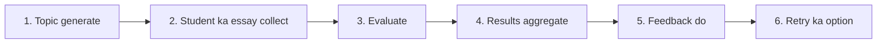

**Step 2: ise LangGraph me graph banao:**

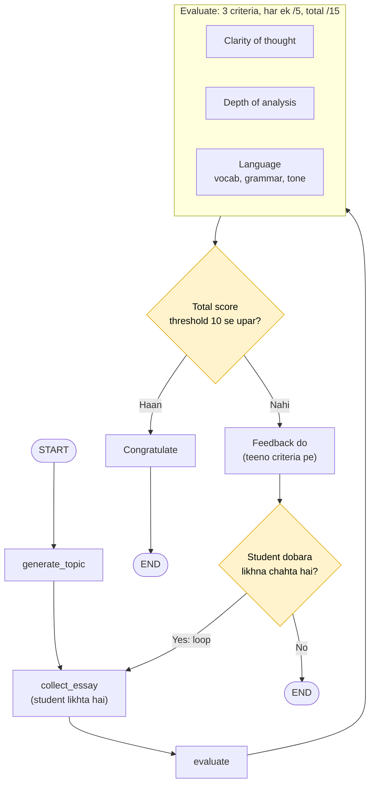

### Node aur Edge kya hain

| | Kya hai | Kaam |
|---|---|---|
| **Node** | Workflow ka **ek single task**. Andar se **sirf ek plain Python function** | **Kya karna hai** |
| **Edge** | Nodes ke beech ka connection | **Kab / agla kya** chalega (control flow) |

> Graph = **Python functions ka set**, jo **edges** se interconnected hain.

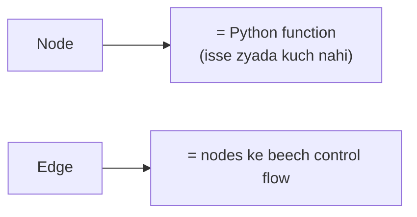

### 4 tarah ke Edges

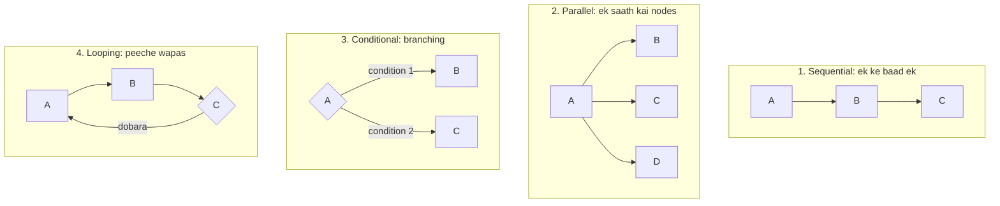

Isliye graph structure me sequential, parallel, branching, looping, sab express ho jaata hai.

### 🔧 UPSC example ka code (video me conceptual tha, ye extra hai)

```python
from langgraph.graph import StateGraph, END

graph = StateGraph(EssayState)
graph.add_node("generate_topic", generate_topic_fn)
graph.add_node("collect_essay", collect_essay_fn)
graph.add_node("evaluate", evaluate_fn)        # clarity / depth / language score

graph.set_entry_point("generate_topic")
graph.add_edge("generate_topic", "collect_essay")
graph.add_edge("collect_essay", "evaluate")

def route_after_eval(state) -> str:
    if state["total_score"] >= 10:
        return "pass"
    return "retry" if state["wants_retry"] else "fail"

graph.add_conditional_edges(
    "evaluate", route_after_eval,
    {"pass": END, "fail": END, "retry": "collect_essay"}   # retry = loop
)

app = graph.compile()
```

---

## 4. State

> **State = shared memory jo tumhare workflow me flow karti hai.** Nodes ke beech pass hone wala saara data isme rehta hai.

**State kyun?** Koi bhi workflow chalane ke liye kuch **data pieces** chahiye hote hain, jo **over time evolve** hote hain.

UPSC workflow ka state:

| Key | Kyun chahiye |
|---|---|
| `topic` | Essay ka topic |
| `essay_text` | Evaluate isi pe hota hai |
| `clarity_score`, `depth_score`, `language_score` | Teeno criteria ke scores |
| `total_score` | Isi pe pass / fail decide hota hai |

**State kaise evolve karti hai (UPSC example):**

| State key ↓ / Node → | generate_topic | collect_essay | evaluate | feedback |
|---|---|---|---|---|
| `topic` | **"Climate change"** | same | same | same |
| `essay_text` | "" | **"essay text..."** | same | same |
| `clarity_score` | 0 | 0 | **4** | 4 |
| `depth_score` | 0 | 0 | **3** | 3 |
| `language_score` | 0 | 0 | **5** | 5 |
| `total_score` | 0 | 0 | **12** | 12 |

### State ki 2 khaasiyat

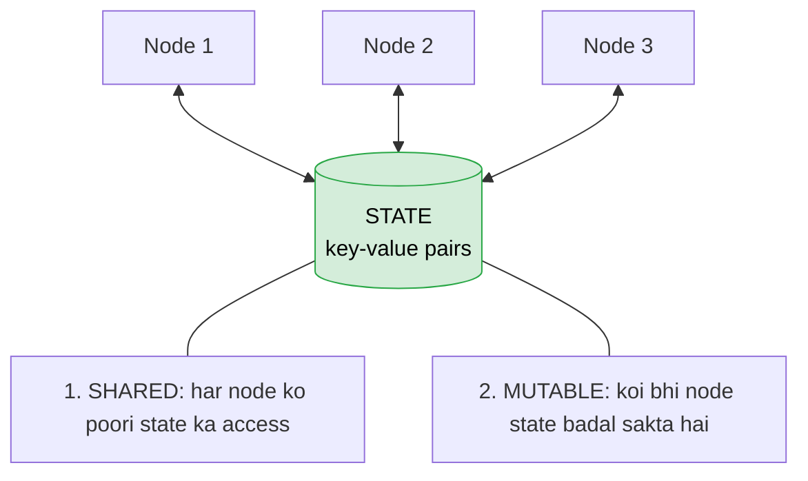

### State kaise flow karti hai

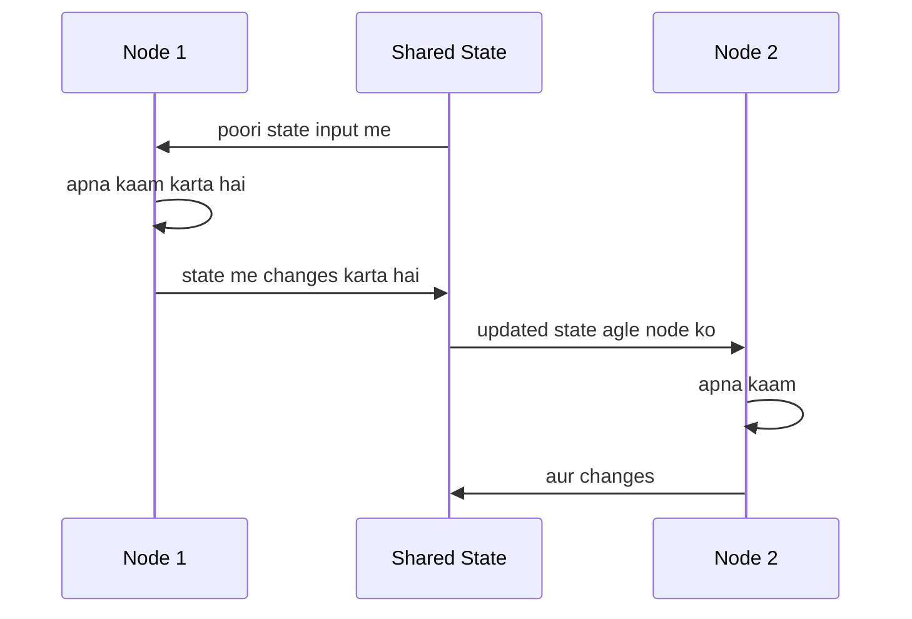

**Kaise banti hai:** Python me ek **TypedDict** (special dictionary / class). Pydantic model bhi chalta hai, par mostly TypedDict.

```python
from typing import TypedDict

class EssayState(TypedDict):
    topic: str
    essay_text: str
    clarity_score: float
    depth_score: float
    language_score: float
    total_score: float
    wants_retry: bool
```

> 🔧 Har node **poori state input me** leta hai aur **sirf wo fields ka dict return** karta hai jo badalna hai. LangGraph use state me **merge** kar deta hai.

---

## 5. Reducers

> State ki "mutable" property se closely connected.

**Default behavior:** node jo value return kare, LangGraph us key ki purani value ko **overwrite (replace)** kar deta hai.

### Problem 1: Calculator (yahan overwrite theek hai)

State: `first_number`, `second_number`, `result`

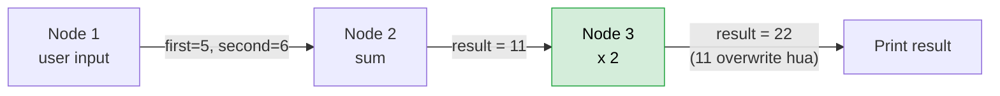
Yahan result ko replace karna **sahi** hai.

### Problem 2: Chatbot (yahan overwrite BREAK karta hai)

State me sirf `messages` key hai.

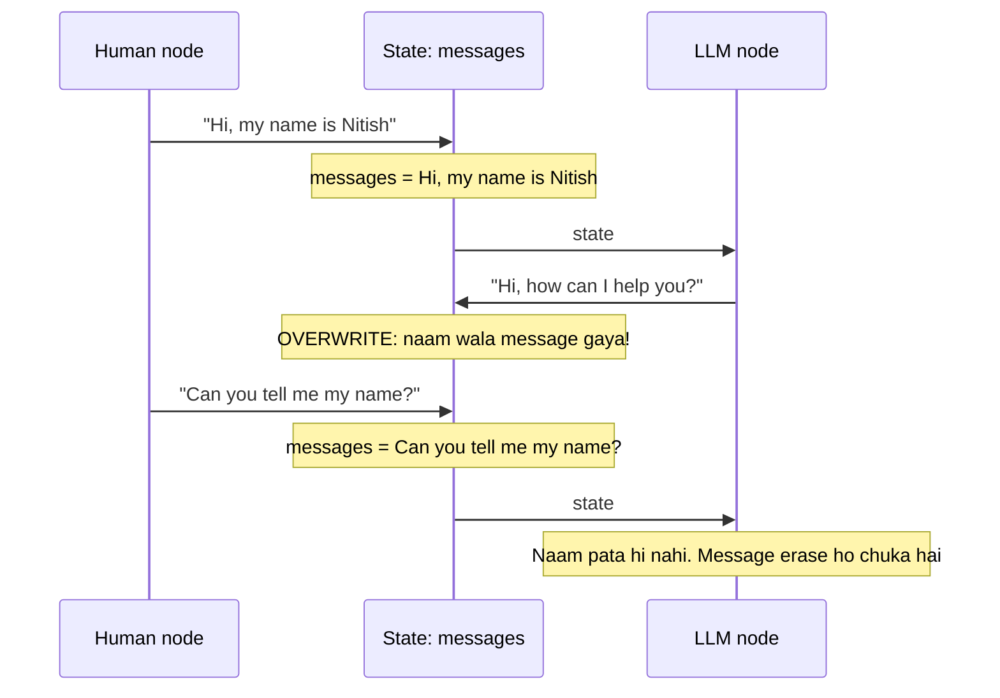

**Fix:** replace ki jagah **har naya message list me ADD (append)** karo.

```mermaid
flowchart TD
    subgraph BAD["❌ Default: Replace"]
        direction LR
        b1["[Hi, my name is Nitish]"] --> b2["[Hi, how can I help you?]"] --> b3["[Can you tell me my name?]"]
    end
    subgraph GOOD["✅ Reducer: Append"]
        direction LR
        g1["[Hi, my name is Nitish]"] --> g2["[Hi my name is Nitish,<br/>Hi how can I help you?]"] --> g3["[... teeno messages ...]"]
    end
    style BAD fill:#f8d7da,stroke:#dc3545,color:#000
    style GOOD fill:#d4edda,stroke:#28a745,color:#000
```

### Problem 3: UPSC example (past essays dekhne hain)

Student apne **pehle, dusre, teesre essay** dekhna chahta hai taaki apna improvement dekhe. Replace karoge to purane gayab. **Add reducer** lagao to sab preserve.

```mermaid
flowchart LR
    subgraph R["Replace"]
        direction LR
        r1["Essay 1"] -. "gaya" .-> r2["Essay 2"] -. "gaya" .-> r3["Essay 3 (sirf ye bacha)"]
    end
    subgraph A["Add reducer"]
        direction LR
        a1["Essay 1"] --> a2["Essay 1, 2"] --> a3["Essay 1, 2, 3 (sab safe)"]
    end
```

### Reducer ki definition

> **Reducer** define karta hai ki nodes ke updates **shared state par kaise apply** honge. **Har key ka apna reducer** ho sakta hai.

```mermaid
flowchart TD
    R(("Reducer")) --> A["Replace<br/>naya purane ko hata de (default)"]
    R --> B["Add / Append<br/>naya purane ke saath jud jaye"]
    R --> C["Merge<br/>dono ko combine karo"]
    K["Har state key<br/>ka apna reducer"] --> R
```

### 🔧 Code (video me conceptual tha, syntax extra hai)

```python
from typing import TypedDict, Annotated
from operator import add
from langgraph.graph.message import add_messages   # chat ke liye built-in reducer

class ChatState(TypedDict):
    messages: Annotated[list, add_messages]   # append hota hai, overwrite nahi

class EssayHistoryState(TypedDict):
    essay_attempts: Annotated[list, add]      # generic append reducer
    total_score: float                        # annotation nahi = default overwrite
```

> `add_messages` plain append se smart hai: message ID se **de-duplication** aur **existing message update** bhi handle karta hai. Chatbot ke liye yehi use hota hai.

**Rule of thumb:** reducers sabse zyada **parallel workflows** me kaam aate hain, jahan kai nodes **ek hi key ko ek saath** update karte hain aur combine karne ka tareeka chahiye. *(Parallel workflow banate waqt coding me dikhaya jayega.)*

---

## 6. Execution Model

LangGraph ka execution model **Google Pregel** se inspired hai (Google ka large-scale graph processing system).

```mermaid
flowchart LR
    P1["Phase 1:<br/>Graph Definition<br/>+ Compilation"] --> P2["Phase 2:<br/>Execution"]
```

### Phase 1: Definition + Compile

```mermaid
flowchart TD
    D["1. DEFINE graph"] --> D1["Nodes define"]
    D --> D2["Edges define"]
    D --> D3["State define<br/>(TypedDict)"]
    D1 & D2 & D3 --> C["2. COMPILE<br/>graph.compile()"]
    C --> CK{"Structure logically<br/>sahi hai?"}
    CK -- "Orphan node mila<br/>(kisi se connected nahi)" --> ERR["Error"]
    CK -- "Sab theek" --> RDY["Graph ready"]
    style ERR fill:#f8d7da,stroke:#dc3545,color:#000
    style RDY fill:#d4edda,stroke:#28a745,color:#000
```

### Phase 2: Execution

```mermaid
flowchart TD
    I["INVOCATION<br/>app.invoke(initial_state)"] --> A1["First node ACTIVATE<br/>(uska Python function call hota hai)"]
    A1 --> U1["Node kaam karke state pe<br/>PARTIAL UPDATE karta hai"]
    U1 --> MP["MESSAGE PASSING<br/>updated state edge se agle node ko"]
    MP --> A2["Agla node ACTIVATE"]
    A2 --> U2["Partial update"]
    U2 --> MP2["Message passing"]
    MP2 --> MORE{"Koi active node ya<br/>edge pe message baaki hai?"}
    MORE -- "Haan" --> A2
    MORE -- "Nahi" --> TERM["TERMINATION<br/>workflow stop"]
    style TERM fill:#d4edda,stroke:#28a745,color:#000
```

### Superstep: "step" nahi, "superstep" kyun?

Ek **round** me **ek se zyada nodes parallel** chal sakte hain, to isse sirf "step" kehna sahi nahi.

```mermaid
flowchart LR
    subgraph SS1["Superstep 1"]
        A["Node A"]
    end
    subgraph SS2["Superstep 2 (3 parallel nodes)"]
        direction TB
        B1["Node B1"]
        B2["Node B2"]
        B3["Node B3"]
    end
    subgraph SS3["Superstep 3"]
        C["Node C"]
    end
    A -- "message passing" --> B1 & B2 & B3
    B1 & B2 & B3 -- "REDUCER se<br/>updates merge" --> C
```

> **1 superstep = 1 step ya kai parallel steps.** Parallel nodes ke updates **reducer** se state me merge hote hain.

### Sequence view: andar kya hota hai

```mermaid
sequenceDiagram
    participant U as Tum (code)
    participant G as LangGraph engine
    participant N1 as Node 1
    participant N2 as Node 2
    U->>G: app.invoke(initial_state)
    G->>N1: activate + state do
    N1-->>G: partial update
    G->>G: state update + message passing
    G->>N2: activate + updated state
    N2-->>G: partial update
    G->>G: koi active node nahi, koi message nahi
    G-->>U: final state (termination)
```

> 🔧 Tum **manually** node 1, phir node 2 call nahi karte. Sirf **ek baar `invoke()`**, baaki message passing + superstep scheduling LangGraph khud karta hai.

```python
app = graph.compile()
result = app.invoke({"topic": "", "essay_text": "", ...})   # complete hone tak chalta hai
print(result)   # saare supersteps ke baad final state
```

### Terminology

| Term | Matlab |
|---|---|
| Graph definition | Nodes, edges, state schema declare karna |
| Compile | Structure validate karna (jaise orphan node pakadna) |
| Invocation | Initial state first node ko dena, execution shuru |
| Activation | Node ka Python function call hona |
| Partial update | Node state ke **kuch** fields hi badalta hai |
| Message passing | Updated state ko edge se agle node(s) tak bhejna |
| Superstep | Execution ka ek round (1 ya kai parallel nodes) |
| Termination | Koi active node nahi + edges me koi message nahi |

---

## 7. Poora video ek hi diagram me

```mermaid
flowchart TD
    WF["LLM Workflow<br/>(5 patterns me se koi bhi)"] --> GR["LangGraph me Graph banao"]
    GR --> NODES["Nodes<br/>(Python functions)"]
    GR --> EDGES["Edges<br/>(sequential, parallel,<br/>conditional, loop)"]
    GR --> STATE["State<br/>(TypedDict, shared + mutable)"]
    STATE --> RED["Reducers<br/>(replace / add / merge)"]
    NODES & EDGES & STATE --> COMP["compile()"]
    COMP --> INV["invoke(initial_state)"]
    INV --> SUP["Supersteps:<br/>activate - partial update -<br/>message passing"]
    SUP --> TERM["Termination: final state"]
```

---

## 8. Glossary

| Term | Matlab |
|---|---|
| Workflow | Goal achieve karne ke liye tasks ki series |
| LLM workflow | Jisme kai tasks LLM pe depend karte hain |
| Prompt chaining | LLM calls ki series, beech me gate |
| Routing | Router LLM decide kare kaun handle karega |
| Parallelization | Fixed independent sub-tasks ek saath |
| Orchestrator-Worker | Sub-tasks runtime pe dynamic, parallel |
| Evaluator-Optimizer | Generate, evaluate, feedback loop |
| Node | Ek task = Python function |
| Edge | Control flow (kab kya) |
| State | Shared, mutable, evolving data (TypedDict) |
| Reducer | State update ka tareeka: replace, add, merge |
| `add_messages` | Chat messages ke liye built-in append reducer |
| Orphan node | Kisi se connected nahi, compile pe error |
| Superstep | Execution ka ek round (parallel nodes ho sakte hain) |
| Pregel | Google ka graph-processing system jisse execution model inspired hai |

---

## 9. Self-test

1. LLM workflow kise kehte hain? *(jisme kai tasks LLM pe depend karte hain)*
2. Parallelization aur Orchestrator-Worker me ek line ka fark? *(sub-tasks pehle se fixed vs runtime pe dynamic)*
3. Evaluator-Optimizer me loop kab rukta hai? *(jab evaluator solution accept kar le)*
4. LangGraph me node andar se kya hota hai? *(plain Python function)*
5. Node aur edge me fark? *(node = kya karna hai, edge = kab / agla kya)*
6. State ki 2 khaasiyat? *(shared + mutable)*
7. State kis se banti hai? *(TypedDict, ya Pydantic model)*
8. Default overwrite chatbot me kyun fail hota hai? *(naya message purane ko replace karta hai, history gayab)*
9. Chat messages ka built-in reducer? *(`add_messages`)*
10. "Superstep" kyun, "step" kyun nahi? *(ek round me kai nodes parallel chal sakte hain)*
11. `compile()` kya check karta hai? *(structure valid hai, jaise koi orphan node nahi)*
12. Execution kab terminate hota hai? *(koi active node nahi + edges me koi message nahi)*
13. Execution model kisse inspired hai? *(Google Pregel)*